# cfr-solver

Nash-equilibrium strategies for imperfect-information games, computed in OCaml
with counterfactual regret minimization (CFR). It solves Kuhn poker, Leduc
hold'em and Liar's dice with seven full-tree CFR variants (vanilla CFR, CFR+,
linear CFR, discounted CFR, DCFR+, and the predictive PCFR+ and PDCFR+), two
Monte Carlo ones (external and outcome sampling) and optimistic FTRL on the
sequence form as a baseline that is not CFR, runs
the Monte Carlo ones in parallel on OCaml 5 domains, and measures how far any
strategy is from equilibrium with an exact best response. For games up to
Leduc's size it also solves the sequence-form linear program in exact rational
arithmetic (its own bignums and simplex), so the game value comes out as a
fraction and a solver's gap can be measured with no rounding. Kuhn and Leduc also
come in three-player (or n-player) versions, where the full-tree variants and
external sampling run on a game signature with payoff vectors and progress is
measured as NashConv. The same machinery covers sealed-bid auctions (first
price, second price and all-pay, with reserves, checked against the Bayes-Nash
bid functions and the discrete theorems in exact arithmetic) and an
interview-style market-making card game solved exactly.
It also builds card
abstractions (hand-strength buckets, optimal 1D k-means, k-medians under earth
mover's distance) and measures exactly what each one costs. For hold'em it
solves river and turn subgames over full ranges with a vectorized CFR on the
public tree, under fixed-limit or no-limit betting, and maps bet sizes that
are missing from the tree onto the ones that are there (action translation).
Turn trees fold suit-isomorphic river cards, can store regrets in 32-bit
floats, skip subtrees no opponent hand reaches or (with regret-based pruning)
no hand of the player acting would take, and can merge hands into
buckets (by E[HS^2] or by the earth mover's distance between distributions of
river hand strength) whose cost is measured in the exact tree. A turn solve can
serve as a blueprint whose rivers are re-solved one at a time, either unsafely
or with one of four gadgets (resolve, max-margin, and both again with reach
gifts) that keep it from getting more exploitable.

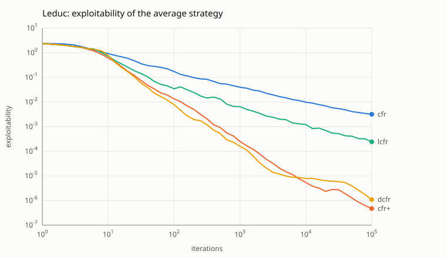

## Example

```
$ dune exec cfr-solver -- solve -n 10000
kuhn: 10000 iterations of cfr in 0.00 s
nodes touched   550000
game value      -0.055546 (player 0)
exploitability  2.318e-03

player 0
  J    p 0.792  b 0.208
  Jpb  p 1.000  b 0.000
  Q    p 1.000  b 0.000
  Qpb  p 0.449  b 0.551
  K    p 0.387  b 0.613
  Kpb  p 0.000  b 1.000

player 1
  Qp  p 1.000  b 0.000
  Qb  p 0.661  b 0.339
  Kp  p 0.000  b 1.000
  Kb  p 0.000  b 1.000
  Jp  p 0.665  b 0.335
  Jb  p 1.000  b 0.000
```

Each row is an information set: the player's card, then the moves so far
(`p` is check or fold, `b` is bet or call). So `Qpb` is player 0 holding the
queen after checking and facing a bet.

The output matches the theory. Kuhn poker has a one-parameter family of
equilibria: player 0 bluffs a jack with some probability alpha in [0, 1/3],
bets a king with 3 alpha and calls with a queen with alpha + 1/3. Here CFR
landed on alpha = 0.208, with the king bet at 0.613 (3 alpha = 0.623) and the
queen call at 0.551 (alpha + 1/3 = 0.541). Player 1's equilibrium is unique
(bluff a jack and call with a queen 1/3 of the time), and CFR gets 0.335 and
0.339. The game is worth -1/18 = -0.0556 to player 0.

`--json FILE` writes the strategy as JSON, `--trace FILE` writes
exploitability at 1, 2, 5, 10, 20, ... iterations as CSV, and `-a` picks the
algorithm (`cfr`, `cfr+`, `lcfr`, `dcfr`, `es`, `os`). The sampled ones take
`--seed`, `--domains D` to run on D domains (`--private` for the deterministic
mode below) and `-w lcfr|dcfr|cfr+` to discount them like the full-tree
variants.

## Leduc hold'em

Leduc is the standard next step after Kuhn: six cards (two each of J, Q, K),
two betting rounds with raises of 2 and 4, a public board card, and pairs
beating high cards. The rules follow OpenSpiel's `leduc_poker`. Suits never
matter, so the solver deals ranks and works with 288 infosets where OpenSpiel
has 936; the uniform policy's NashConv comes out at 4.747222, the value
OpenSpiel's tests use.

```
$ dune exec cfr-solver -- solve -g leduc -a dcfr -n 10000
leduc: 10000 iterations of dcfr(1.5,0,2) in 0.34 s
nodes touched   38780000
game value      -0.085606 (player 0)
exploitability  7.805e-06
```

Player 0 loses 0.0856 chips a hand at equilibrium, the value usually quoted for
Leduc. A few of the first-round decisions from that run (`c` is check or call,
`r` raise, `f` fold):

| infoset | meaning                              | f     | c     | r     |
|---------|--------------------------------------|------:|------:|------:|
| `J:`    | player 0 opens with a jack           |       | 0.928 | 0.072 |
| `K:`    | player 0 opens with a king           |       | 0.248 | 0.752 |
| `J:cr`  | player 0 checked a jack, faces a raise | 0.946 | 0.036 | 0.018 |
| `J:r`   | player 1 holds a jack, faces a raise | 0.819 | 0.126 | 0.055 |
| `K:c`   | player 1 holds a king after a check  |       | 0.000 | 1.000 |

Leduc's equilibrium is not unique, so another algorithm can land on different
mixes with the same value and exploitability.

## Liar's dice

Each player rolls one hidden six-sided die. Players take turns bidding a
quantity and a face ("2x3": at least two threes between both dice), each bid
higher than the last (more dice, or the same number of a higher face), until
someone calls `liar`. If the bid holds, the bidder wins 1, otherwise the
caller does. Sixes are wild, so they count toward any other face. These are
OpenSpiel's `liars_dice` rules with their default parameters, and the tree has
the same 24,576 infosets: one per die value and per set of bids made so far,
since bids only go up. `Liars_dice.game` builds any number of dice and faces,
with or without wilds; dice are dealt as sorted multisets with multinomial
weights, so two dice of six faces are 21 deals per player instead of 36.

```
$ dune exec cfr-solver -- solve -g liars -a dcfr -n 5000 --show 3: --show 4: --show 6: --show 3:1x6
liars-1d6: 5000 iterations of dcfr(1.5,0,2) in 39.92 s
nodes touched   2948770000
game value      -0.027132 (player 0)
exploitability  2.235e-06

  3:  1x3 0.698  1x4 0.233  1x5 0.070
  4:  1x4 0.930  1x5 0.070
  6:  1x3 0.279  1x4 0.312  1x5 0.408
  3:1x6  2x2 0.004  2x3 0.425  liar 0.571
```

The first player loses 7/258 (0.027132) a game. That number was checked
independently: a separate Python script, written from the rules rather than
from this code, builds the sequence-form linear program and solves it with
HiGHS. Every value it found sits within 1e-10 of a fraction with a small
denominator. The tests hold CFR to the variants up to 1 x 4, to 2 x 2 and to
-7/258; 2,000 DCFR iterations on 1 x 6 without wilds and on 2 x 3 give
-0.111111 and 0.061728.

| dice x faces | infosets | sixes (top face) wild | no wilds |
|-------------:|---------:|----------------------:|---------:|
| 1 x 2        | 32       | 1/2                   | 0        |
| 1 x 3        | 192      | 1/9                   | -1/9     |
| 1 x 4        | 1,024    | 1/16                  | -1/8     |
| 1 x 5        | 5,120    | 1/125                 | -3/25    |
| 1 x 6        | 24,576   | -7/258                | -1/9     |
| 2 x 2        | 768      | 7/8                   | 1/8      |
| 2 x 3        | 24,576   | 5/81                  | 1/81     |

With one die and no wilds the first player is behind whenever there are more
than two faces. With wilds the opener starts ahead, and the edge shrinks as
faces are added until it flips at six. The opening strategy shows the
equilibrium bluffing: a 3 opens 1x4 or 1x5 30% of the time, and a wild six,
which supports any face, spreads across 1x3, 1x4 and 1x5. Openings with a 1 and
a 2 come out identical: neither die backs any bid the strategy makes, so the
two hands are interchangeable.

The same six-algorithm comparison as for Leduc, with N = 2,000 (about 1.18
billion nodes touched; a full pass over the tree is 294,877 nodes):

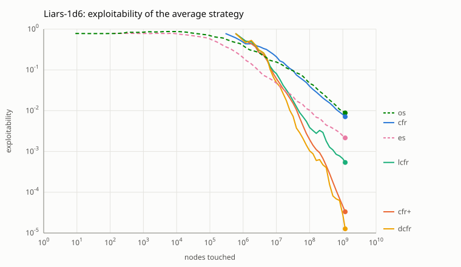

| Liar's dice, nodes | cfr     | cfr+    | lcfr    | dcfr    | es      | os      |
|-------------------:|--------:|--------:|--------:|--------:|--------:|--------:|
| 10^6               | 5.11e-1 | 7.81e-1 | 7.81e-1 | 7.81e-1 | 2.34e-1 | 4.45e-1 |
| 10^7               | 2.44e-1 | 7.94e-2 | 9.35e-2 | 6.49e-2 | 5.47e-2 | 1.63e-1 |
| 10^8               | 4.90e-2 | 2.77e-3 | 5.50e-3 | 1.44e-3 | 1.13e-2 | 5.72e-2 |
| 1.18 x 10^9        | 7.11e-3 | 3.31e-5 | 5.39e-4 | 1.27e-5 | 2.40e-3 | 9.76e-3 |
| cpu seconds        | 19.5    | 17.2    | 16.6    | 16.8    | 32.9    | 73.1    |

Here external sampling ends three times less exploitable than vanilla CFR on
the same work, where on Leduc it ended 2.6 times worse. A likely reason: the tree is
wide and shallow (up to 12 bids at a node, at most 13 moves deep), so a
sampled iteration that walks every action of one player and one action of
the other skips most of it, and the 36 deals average out quickly. DCFR is
again the best full-tree method, 2.6 times ahead of CFR+ at the end.

## Playing the solver

`cfr-solver play -g GAME` solves the game with DCFR and deals hands against
the result, alternating seats unless `--seat` picks one. The prompt is the
infoset key, your private card or die followed by the public actions so far,
then the legal actions; type one or its number. After each hand every move is
listed with the infoset it was made from, so the bot's die or card shows up
there:

```
$ dune exec cfr-solver -- play -g liars --hands 1 --seed 3
liars-1d6: 2000 iterations of dcfr, exploitability 1.267e-05
game value of the bot's strategy: -0.0271 per hand to player 0

hand 1, you are player 0
1:    1x1 1x2 1x3 1x4 1x5 1x6 2x1 2x2 2x3 2x4 2x5 2x6
> 2
1:1x2,1x5    1x6 2x1 2x2 2x3 2x4 2x5 2x6 liar
> liar
  you 1x2   at 1:
  bot 1x5   at 5:1x2
  you liar  at 1:1x2,1x5
you lose 1, running total -1

1 hand, -1 total, -1.000 per hand
```

`Play.Make` is the same loop as a library function that takes the human's
choices as a callback, which is how the tests drive it: two copies of Kuhn's
equilibrium playing 200,000 sampled hands average -1/18 for player 0 to within
four standard errors.

## Three players

Two-player zero-sum is where CFR has its guarantee: the average strategy goes
to a Nash equilibrium. With three players it doesn't, and a Nash equilibrium
is a weaker promise anyway (each player's best reply to the other two, with no
game value to speak of). `Multi.S` is the game signature for any number of
players: terminals carry a payoff vector and decisions name a player index.
`Multi_cfr`, `Multi_br` and `Multi.Eval` are the solver, best response and
evaluator over it, and `Multi.Of_game` lifts any two-player game into it.
`Kuhn_n.game n` and `Leduc_n.game n` follow OpenSpiel's n-player rules: n + 1
ranks (two suits for Leduc), an ante of 1 each, and for Leduc folded players
are skipped and a round closes once everyone left has called the last raise.

Progress is NashConv, the sum over players of what each gains by switching to
a best response while the others keep their strategies:

```
$ dune exec cfr-solver -- multi -g kuhn3 -n 100000
kuhn3: 3 players, 48 infosets

nash conv of the average strategy
 iteration        cfr       cfr+       lcfr       dcfr
       100  8.952e-02  2.955e-03  6.905e-03  6.135e-03
      1000  1.657e-02  3.203e-05  1.500e-04  2.315e-05
     10000  2.772e-03  7.850e-07  6.022e-06  3.813e-08
    100000  1.010e-03  1.453e-07  4.214e-07  6.129e-10

            ms/it  values                         gains
cfr         0.010  -0.029475 -0.020676 +0.050150  2.275e-04 3.730e-04 4.100e-04
cfr+        0.026  -0.026888 -0.020833 +0.047721  1.652e-08 1.276e-07 1.186e-09
lcfr        0.026  -0.026232 -0.020833 +0.047065  4.693e-09 4.108e-07 5.923e-09
dcfr        0.029  -0.026100 -0.020833 +0.046933  4.767e-12 4.231e-10 1.850e-10
```

(Only some checkpoints are shown.) Three-player Kuhn is a four-card
deck, T J Q K. Szafron, Gibson and Sturtevant (AAMAS 2013) worked out a family
of equilibria for it by hand, with a parameter beta in [0, 1] that the second
player uses to move value between the other two: the first player gets
-(1 + 2 beta)/48 per hand, the second always -1/48, the third (1 + beta)/24.
The solver lands in that family without being told about it. The second
player's value is -0.020833 (-1/48) under CFR+, LCFR and DCFR, the first and
third match the formulas at beta = 0.126 for DCFR, and the first player never
opens with a bet, which is a feature of the family. The second player's
indifference also shows up in the run: beta for CFR+ moves from 0.138 at 1,000
iterations to 0.136 at 10,000 and 0.145 at 100,000 while NashConv keeps
falling, because every point on that segment is an equilibrium and nothing
pins the average to one of them.

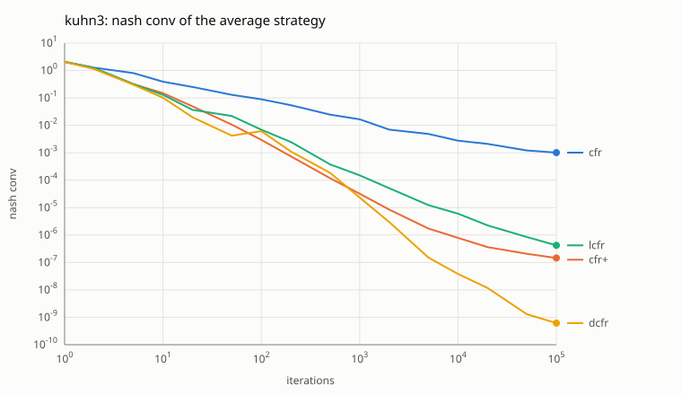

Leduc is where it gets less tidy. Lu, Zhu and Zhao (2023, score-based
equilibrium learning) report CFR failing to bring NashConv down any further on
three-player Leduc. The sizes in their table (13,878 infosets) match a
six-card deck, J Q K in two suits, which is `leduc3-6` here. With three hole
cards and a board out of six cards there is a lot of card removal.

```
$ dune exec cfr-solver -- multi -g leduc3-6 -n 1000
leduc-3p-3r: 3 players, 4203 infosets
 iteration        cfr       cfr+       lcfr       dcfr
       100  1.303e+00  1.829e-01  5.192e-01  1.490e-01
       200  9.905e-01  5.712e-02  2.782e-01  3.968e-02
       500  6.154e-01  1.353e-02  1.368e-01  1.852e-02
      1000  5.040e-01  4.676e-03  1.547e-01  1.302e-02

            ms/it  values                         gains
cfr         1.578  -0.094658 +0.000463 +0.094196  1.555e-01 1.776e-01 1.709e-01
cfr+        4.221  -0.001474 -0.194565 +0.196039  1.297e-03 1.895e-03 1.484e-03
lcfr        4.157  -0.066414 -0.050438 +0.116853  5.341e-02 3.997e-02 6.128e-02
dcfr        4.061  -0.052683 -0.025511 +0.078194  5.447e-03 4.311e-03 3.262e-03
```

LCFR goes back up between 500 and 1,000 iterations and DCFR flattens out
after 500. The values
disagree too: CFR+ ends near an approximate equilibrium where the second
player loses 0.195 a hand and the first breaks even, DCFR near one where the
second player loses 0.026. Both have every player within 0.006 of a best
response, so these are different approximate equilibria, not one equilibrium
reached at different speeds. Here the algorithm picks the equilibrium.

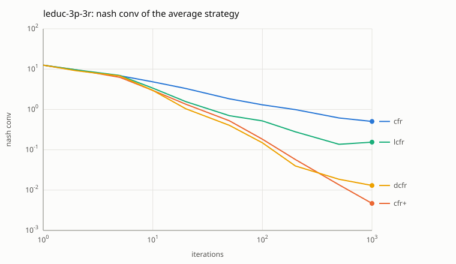

With the eight-card deck (T J Q K in two suits, OpenSpiel's default for three
players) the picture is closer to the two-player one, with one exception:

```
$ dune exec cfr-solver -- multi -g leduc3 -n 10000
leduc-3p: 3 players, 7428 infosets
 iteration        cfr       cfr+       lcfr       dcfr
      1000  1.458e-01  6.948e-03  2.033e-02  3.702e-03
      2000  9.228e-02  3.546e-03  1.894e-02  1.734e-03
      5000  5.757e-02  1.786e-03  1.615e-02  5.844e-04
     10000  5.066e-02  1.652e-03  1.868e-02  2.975e-04

            ms/it  values                         gains
cfr         3.850  -0.083587 -0.009240 +0.092827  1.266e-02 1.648e-02 2.151e-02
cfr+       10.394  -0.094972 -0.008612 +0.103584  6.078e-04 6.065e-04 4.376e-04
lcfr       10.300  -0.084803 -0.008830 +0.093633  5.480e-03 6.246e-03 6.957e-03
dcfr       10.475  -0.094683 -0.008702 +0.103384  1.035e-04 1.078e-04 8.618e-05
```

DCFR keeps falling (3.0e-4 at 10,000 iterations) and CFR+ slows down, but
LCFR stops near 2e-2 from 1,000 iterations on and drifts back up. CFR+ and
DCFR agree on the values to about 3e-4 here, so in the bigger deck they head
for the same region of the strategy space.

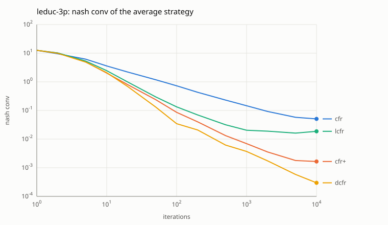

The game sizes are checked against the paper's table: with suits told apart
(OpenSpiel's convention) the six-card game has 13,878 infosets and 396,120
histories, and two-player Leduc 936 and 9,450. `Leduc_n` merges suits, which
gives 4,203 and 288 infosets, so the test converts back by counting two suited
versions of every first-round infoset, two of every second-round infoset that
pairs the board and four of the rest.

The n-player solver started as a direct recursion that returned a fresh
utility vector from every node. Moving to flat regret tables and per-depth
buffers, the way `Cfr` already works, took two-player Leduc from 0.204 to
0.055 ms an iteration (the two-player solver does 0.040) and eight-card
three-player Leduc from 40.2 to 12.2 ms, with identical output.

### External sampling with three or more players

`Multi_mccfr` is external-sampling MCCFR on `Multi.S`, the way Lanctot
describes it for n players: one pass per player, where the player traversing
tries every action at their own decisions and everything else (chance and all
the other players) is sampled once from the current strategy. The sampled
counterfactual value of a terminal is just its payoff, so the regret update is
the same as with two players. On a two-player game lifted with `Multi.Of_game`
it reproduces `Mccfr` bit for bit: same nodes touched, same regrets, same
average strategy, under vanilla weighting, DCFR every 10 iterations and linear
weighting, on Kuhn and Leduc.

The part that does not carry over is the average strategy. With two players,
external sampling adds the current strategy at every opponent node it passes.
A node of player p is reached with probability pi_c(h) pi_p(h) when the other
player is the one traversing, and pi_c summed over an infoset is the same
every iteration, so this is the reach-weighted average up to a constant per
infoset. With three players the traverser's pass also samples the third
player, and the visit probability picks up that player's reach as well. The
average then weights each iteration by how likely a third party was to let the
game get there, which has nothing to do with p. OpenSpiel's code says as much
about its default ("does not compute the estimate as described by the
(unbiased) stochastically-weighted averaging") and keeps it because it is
faster and seems to work better. There are three options here:

- `Simple`: add the current strategy at every non-traverser node (the
  two-player rule, biased with three players).
- `Weighted`: add it divided by the sampled reach of the players other than
  the traverser and the owner. In expectation that is pi_p(I) sigma(I) times
  the sum of pi_c over the infoset, the right weight.
- `Full`: an exact walk of the whole tree after every iteration, weighting by
  own reach, like OpenSpiel's `FULL`. Exact and no longer cheap.

The test that tells them apart freezes the regrets and alternates two fixed,
very different profiles A and B on three-player Kuhn, so the right answer is
the own-reach-weighted mix of A and B, computed exactly. The largest error over
all infosets, by number of rounds:

| rounds  | simple | weighted |
|--------:|-------:|---------:|
| 5,000   | 0.053  | 0.035    |
| 20,000  | 0.052  | 0.010    |
| 80,000  | 0.046  | 0.0064   |
| 320,000 | 0.046  | 0.0025   |

The weighted error falls like one over the square root of the samples; the
simple one settles at 0.046 and stays there. `Full` matches to 1e-12.

Then whole runs, at equal nodes touched (every node a traversal visits or a
full-tree pass walks), with full-tree vanilla CFR and DCFR for reference and
three seeds averaged for each sampled run. `es-linear` is simple averaging
with linear weighting applied every 1,000 iterations (discounting every table
entry every iteration would cost far more than the traversal).

```
$ dune exec cfr-solver -- multi-es -g leduc3 -b 3000000000 --seeds 3
leduc-3p: 3 players, mean of 3 seeds for the sampled runs

nash conv of the average strategy
 nodes touched          cfr         dcfr           es  es-weighted      es-full    es-linear
     1.000e+05    1.261e+01    1.261e+01    6.458e+00    6.537e+00    1.276e+01    6.423e+00
     1.000e+06    6.170e+00    9.884e+00    1.860e+00    1.914e+00    1.284e+01    1.573e+00
     1.000e+07    1.298e+00    1.073e+00    3.579e-01    3.782e-01    1.211e+01    2.696e-01
     1.000e+08    2.264e-01    2.173e-02    8.048e-02    8.595e-02    8.539e+00    7.058e-02
     1.000e+09    6.701e-02    2.771e-03    3.035e-02    3.454e-02    2.949e+00    3.212e-02
     3.000e+09    4.262e-02    7.009e-04    2.360e-02    2.693e-02    1.652e+00    2.766e-02

                  cpu s  values (first seed)
cfr               79.58  -0.083174 -0.009766 +0.092940
dcfr              72.48  -0.094634 -0.008780 +0.103415
es                94.47  -0.082719 -0.008722 +0.091442
es-weighted      101.31  -0.082693 -0.008815 +0.091509
es-full           32.13  -0.102767 -0.052449 +0.155216
es-linear         95.05  -0.082806 -0.009035 +0.091841
```

(Only some checkpoints are shown.) External sampling is ahead until about 2e7
nodes, and then DCFR passes it and keeps going: 7.0e-4 at 3e9 against 2.4e-2.
Against vanilla CFR, which is what external sampling estimates, it stays about
twice as good the whole way. The unbiased average loses to the biased one at
every checkpoint, by up to 22 percent near the end (on the six-card deck it
is 0 to 11 percent behind and finishes 2 percent ahead, inside the noise). Dividing by a reach that can be small
makes some updates very large, and that variance costs more than the bias,
which shrinks on its own as consecutive strategies get closer together. `Full`
is hopeless when measured this way: every iteration pays for the whole tree to
average a strategy that only moved along a few sampled paths. Linear weighting
helps early and ends slightly behind plain averaging.

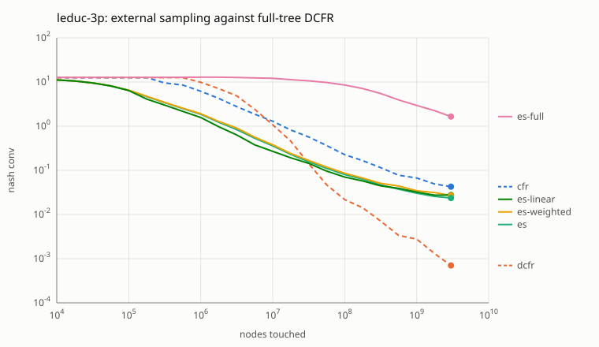

The six-card deck is the game where vanilla CFR stalls (Lu, Zhu and Zhao), and
external sampling stalls with it:

```
$ dune exec cfr-solver -- multi-es -g leduc3-6 -b 3000000000 --seeds 3
 nodes touched          cfr         dcfr           es  es-weighted      es-full    es-linear
     1.000e+07    1.099e+00    3.332e-01    5.825e-01    6.404e-01    1.145e+01    5.170e-01
     1.000e+08    4.521e-01    1.649e-02    2.061e-01    2.192e-01    5.747e+00    2.372e-01
     1.000e+09    2.786e-01    1.098e-02    1.951e-01    1.962e-01    1.603e+00    2.286e-01
     3.000e+09    3.238e-01    9.216e-03    1.910e-01    1.879e-01    9.453e-01    2.025e-01
```

From 1e8 nodes on, every sampled variant except `Full` sits between 0.16 and
0.24 and full vanilla CFR wanders between 0.28 and 0.45. DCFR gets to 9.2e-3.
So the stall belongs to plain regret matching in this game, not to sampling,
and discounting is what gets past it.

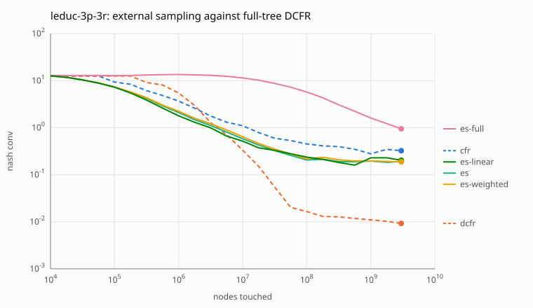

Four players is where sampling pays for itself. `leduc4` (ten cards, five
ranks in two suits) has 25.7 million nodes and 127,980 infosets; one DCFR
iteration touches 1e8 nodes and takes about 5 s, while an external-sampling
iteration touches 159 on average.

```
$ dune exec cfr-solver -- multi-es -g leduc4 -r dcfr,es,es-weighted -b 10000000000 --start 100000000
leduc-4p: 4 players, mean of 1 seed for the sampled runs

nash conv of the average strategy
 nodes touched         dcfr           es  es-weighted
     1.000e+08    2.231e+01    2.412e-01    2.449e-01
     1.000e+09    2.654e+00    4.078e-02    4.649e-02
     3.162e+09    4.321e-01    2.251e-02    2.833e-02
     1.000e+10    5.402e-02    1.253e-02    1.320e-02

                  cpu s  values (first seed)
dcfr             469.52  -0.094921 -0.066970 +0.020163 +0.141728
es               697.47  -0.093973 -0.065417 +0.017150 +0.142241
es-weighted      738.25  -0.093793 -0.065385 +0.016903 +0.142276
```

External sampling gets to DCFR's final 5.4e-2 at about 7e8 nodes, fourteen
times fewer, and is still ahead at 1e10, when DCFR has done 97 iterations.
Per node it is slower (14 million nodes a second against 21 million, since
sampled paths jump around a tree of several gigabytes), so in CPU time the
gap is about ten times rather than fourteen. The values agree to about 3e-3.
The process sat at about 4.8 GB.

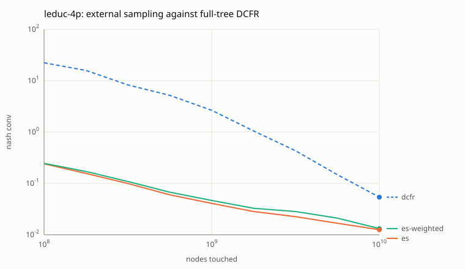

Measuring NashConv on a 25.7-million-node game needed a faster best response.
`Multi_br` used to walk the game through `G.node`, look up every strategy by
string key, and pick the best action of an infoset by evaluating the subtrees
under it, which then got evaluated again on the way back up. It now works on
the same flat tree as the solvers. One pass collects, for each of the
responder's infosets, the histories in it and the reach of everyone else. The
infosets are then sorted by how many of the responder's own decisions come
before them, deepest first, so that by the time an infoset picks its action
every decision of the responder below it is already made. Perfect recall is
what makes that order well defined. Same NashConv to twelve digits; eight-card
three-player Leduc went from 1.17 s to 0.028 s and four-player Leduc from
204 s to 12.4 s. The old version is kept in the tests as a reference and the
two are compared on random profiles.

### Which equilibrium

On the six-card deck CFR+ and DCFR end at different approximate equilibria.
`multi-select` runs both for a number of iterations and external sampling
(weighted averaging) with several seeds, then compares the end points with a
reach-weighted distance: for each player, the total variation between the two
strategies at each infoset, weighted by how often the infoset is reached under
either profile. It also builds the mix of the seeds. `Multi_profile.mix`
averages each player's strategies weighted by that player's own reach, which
plays exactly like picking one of the profiles at random for that player (the
test checks that the values come out as the mean).

```
$ dune exec cfr-solver -- multi-select -g leduc3-6 -n 5000 -b 3000000000 --seeds 5
          nash conv  values
cfr+      1.286e-03  -0.0009 -0.1943 +0.1952
dcfr      1.092e-02  -0.0518 -0.0231 +0.0749
es1       1.866e-01  -0.0930 -0.0116 +0.1047
es2       1.915e-01  -0.0648 +0.0396 +0.0251
es3       1.858e-01  -0.0718 -0.0135 +0.0852
es4       1.411e-01  -0.0719 +0.0089 +0.0630
es5       1.677e-01  -0.0853 +0.0087 +0.0766
es-mix    1.165e-01  -0.0779 +0.0063 +0.0716

nash conv of the mix of the first k seeds
  1  1.866e-01  -0.0930 -0.0116 +0.1047
  2  1.542e-01  -0.0790 +0.0138 +0.0652
  3  1.347e-01  -0.0771 +0.0053 +0.0718
  4  1.197e-01  -0.0760 +0.0061 +0.0698
  5  1.165e-01  -0.0779 +0.0063 +0.0716
```

The distances between CFR+ and DCFR are 0.12, 0.16 and 0.07 for the three
players. The sampled seeds are 0.025 to 0.062 from each other, 0.03 to 0.08
from DCFR and 0.10 to 0.19 from CFR+. So the seeds land in the same region as DCFR,
where the second player loses about 0.02 a hand, and not in CFR+'s, where they
lose 0.19. Mixing the seeds brings NashConv down from 0.19 to 0.12, and the
mix is 0.014 to 0.040 from the seeds, roughly half their distance from each
other, which is what noise around a single point looks like. With three players a mix of equilibria
is not in general an equilibrium, so this only says that the seeds have not
split between different ones. CFR+ is the odd one out.

## Convergence

`cfr-solver compare -g GAME -n N --svg FILE` runs the six algorithms below on
the same budget of work (`--algorithms` picks others) and plots
exploitability of the average strategy. Work is
counted in nodes touched, because an iteration means very different things: a
full-tree pass over Leduc visits 1,939 nodes, an external-sampling iteration
about 45 and an outcome-sampling one about 16. The budget is what N iterations
of an alternating full-tree variant cost (vanilla CFR updates both players in
one pass, so it gets 2N iterations). The chart at the top is Leduc with
N = 100,000, about 388 million nodes; dashed lines are the sampled methods.

| Leduc, nodes | cfr      | cfr+     | lcfr     | dcfr     | es       | os       |
|-------------:|---------:|---------:|---------:|---------:|---------:|---------:|
| 1,000        | -        | -        | -        | -        | 2.92     | 2.59     |
| 100,000      | 3.05e-1  | 1.60e-1  | 2.28e-1  | 1.57e-1  | 5.16e-1  | 1.43     |
| 10^7         | 1.73e-2  | 7.50e-5  | 3.97e-3  | 3.35e-5  | 2.83e-2  | 1.13e-1  |
| 3.88 x 10^8  | 2.03e-3  | 4.73e-7  | 2.43e-4  | 1.10e-6  | 5.26e-3  | 1.09e-2  |
| cpu seconds  | 3.47     | 3.77     | 3.64     | 3.64     | 4.94     | 7.50     |

Per node touched, neither sampler beats vanilla CFR on Leduc: external sampling
ends about 2.6 times more exploitable and outcome sampling about 5 times. They
do something else well. Each iteration is cheap, so they start learning before a
single full pass has finished, and their cost per iteration doesn't grow with
the tree, which is what matters once a game is too big to walk. CFR+ and DCFR
are in another league on a game this small: after the same work CFR+ is about
4,000 times less exploitable than vanilla CFR. Linear CFR, which keeps negative
regrets and only reweights them, stalls on Leduc; Brown and Sandholm saw the
same kind of game dependence (it was poor on Goofspiel). The Kuhn chart is in
[docs/kuhn.svg](docs/kuhn.svg), and the raw curves are in `docs/*.csv`.

## Predictive CFR+

CFR+ picks its next strategy by regret matching on the accumulated regrets.
Predictive CFR+ (Farina, Kroer and Sandholm, "Faster Game Solving via
Predictive Blackwell Approachability", AAAI 2021) guesses that the next
iteration's instantaneous regret will be the same as the last one and matches
on the sum instead:

```
R_t       = [R_{t-1} + r_t]^+              accumulated, as in CFR+
x_{t+1}  ~  [R_t + r_t]^+                  matched on the prediction
average     weighted by t^2
```

PDCFR+ (Xu et al., "Minimizing Weighted Counterfactual Regret with Optimistic
Online Mirror Descent", IJCAI 2024) does the same on top of DCFR+, which is
DCFR with negative regrets clipped to zero like CFR+:

```
R_t       = [R_{t-1} d(t-1) + r_t]^+       d(t) = t^alpha / (t^alpha + 1)
x_{t+1}  ~  [R_t d(t) + r_t]^+
average     weighted by t^gamma
```

with alpha = 2.3 and gamma = 5 from the paper's grid search; DCFR+ uses alpha
= 1.5, gamma = 4. All of them update the two players in turn.

In `Cfr.Make` this takes two extra arrays: the instantaneous regrets of the
pass in progress, summed over the histories of each infoset, and those of the
last pass, which they replace when the pass ends. The stored regrets are already multiplied by d(t) at the
end of each pass (that is how the existing DCFR discount works), so matching
on stored + last is exactly the paper's [R_t d(t) + r_t]^+ without a second
copy of R. The subgame solver goes the other way: its regret store holds the
predicted regrets themselves, R d(t) + r, and keeps R d(t) and r on the
side. After
a pass, the new instantaneous regret is the store minus both, and the store is
rewritten. None of the matching code (buckets, suit folding, float32 storage,
pruning) had to change, because it only ever reads the store.

`cfr-solver compare --algorithms cfr+,dcfr,dcfr+,pcfr+,pdcfr+` runs any subset
on the same budget of nodes touched, and `cfr-solver subgame -a ...` does the
same for hold'em spots. Exploitability of the average strategy:

| game, budget                      | cfr+     | dcfr     | dcfr+    | pcfr+    | pdcfr+   |
|-----------------------------------|---------:|---------:|---------:|---------:|---------:|
| Kuhn, 10,000 iterations           | 9.63e-6  | 2.39e-5  | 1.01e-5  | 2.36e-11 | 2.36e-16 |
| Leduc, 3,000 iterations           | 3.67e-5  | 1.62e-5  | 1.49e-5  | 1.02e-4  | 1.36e-4  |
| Leduc, 100,000 iterations         | 4.73e-7  | 1.10e-6  | 5.62e-7  | 2.42e-8  | 3.26e-12 |
| Liar's dice, 3,000 iterations     | 1.56e-5  | 4.28e-6  | 1.78e-5  | 1.01e-4  | 1.61e-4  |
| river (% of pot), 20,000 iter.    | 2.32e-5  | 8.70e-6  | 6.74e-6  | 3.79e-5  | 6.09e-5  |
| turn (% of pot), 600 iterations   | 1.61e-2  | 4.89e-3  | 4.63e-3  | 1.84e-2  | 1.63e-2  |

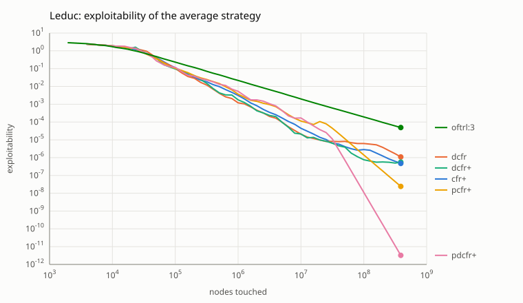

The Kuhn, Liar's dice, river and turn curves are in `docs/*-modern.svg`, with
the raw numbers in the matching CSV files.

On Kuhn poker prediction wins outright: PDCFR+ reaches machine precision in
about 9,000 iterations. On Leduc the predictive variants start behind and
overtake later. At 3,000 iterations PDCFR+ is eight times worse than DCFR; at
100,000 it is 340,000 times better. Xu et al. describe the same shape on Leduc
(slower at first, ahead after about 10,000 iterations), and the crossover here
is between 3,000 and 26,000 iterations. On Liar's dice at 3,000 iterations, the
limit river at 20,000 and the limit turn at 600 (a 203 MB tree, 4,330 decision
nodes), DCFR and DCFR+ stay ahead and the predictive variants are among the
slowest, which matches Farina et al.'s own
finding that DCFR beats PCFR+ on Leduc and on river endgames at the budgets
they plotted. Which method is fastest depends on the game and on how long it
runs.

**The last iterate.** The table above is about the average strategy, which is
what CFR's guarantee covers. `compare --last` tracks the current strategy
instead, and here the predictive variants do something the others don't:

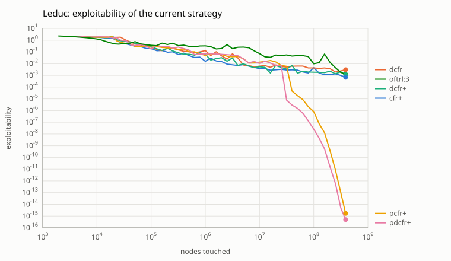

After 100,000 iterations on Leduc the current strategy of PCFR+ is 1.7e-15
from equilibrium and PDCFR+ 5.0e-16, while CFR+, DCFR and DCFR+ hover between
6.9e-4 and 3.0e-3 and improve only slowly. On Kuhn the current strategy of PCFR+
is exactly an equilibrium (exploitability 0 in floating point) after 5,000
iterations. Regret matching without prediction tends to circle around the
equilibrium (Farina et al. 2023 study when RM+ is unstable); the prediction
damps the circling. For the predictive variants the
current strategy ends up better than the average, which is still dragged
down by early iterations.

**Optimistic FTRL with dilated entropy.** As a baseline that is not CFR at
all, `Dilated` runs follow-the-regularized-leader directly on the sequence
form (Farina, Kroer and Sandholm, "Optimistic Regret Minimization for
Extensive-Form Games via Dilated Distance-Generating Functions", NeurIPS
2019). The regularizer is the dilated entropy, sum over infosets j of
x_parent(j) times the negative entropy of the local strategy at j. Its argmax
against a utility vector has a closed form computed bottom-up: at each infoset
the local strategy is a softmax of eta times (utility of the action plus the
values of the infosets just below it), and the infoset's value, a log-sum-exp
divided by eta, is passed up to its parent sequence. Optimism adds the last
gradient once more before solving. A property test checks the closed form
against random strategies and small perturbations of it on a hand-built
four-infoset treeplex, so the softmax recursion is checked as a maximizer, not
against itself.

With the same weight on every infoset it is far behind CFR+ on averages: on
Leduc with eta = 3 it ends at 4.9e-5 against CFR+'s 4.7e-7 after the same
work, and eta = 10, 30 and 100 did worse. Optimism matters for the last
iterate: on Kuhn, optimistic FTRL with eta = 1 has a current strategy 2.9e-14
from equilibrium after the work of 5,000 CFR+ iterations (10,000 of its own,
since it updates both players in one pass), while plain FTRL with the same
step is still 0.25 away. Farina et al. use per-infoset weights on the regularizer
to get their convergence bounds, which this version leaves out.

## Exact equilibria

`cfr-solver exact` writes the sequence-form linear program (Koller, Megiddo
and von Stengel 1996) for each player and solves it with a simplex in exact
rational arithmetic. There is no GMP dependency: `Bigint` is sign-magnitude
with 30-bit limbs (Knuth's algorithm D for division) and a fast path for
numbers that fit in one machine word, and `Rat` keeps fractions in lowest terms
with the gcd tricks from Knuth 4.5.1. The two LPs, max over x of min over y and
the reverse, must give the same value exactly, and the solver fails loudly if
they don't.

```
$ cfr-solver exact -g leduc
leduc: 337 + 337 sequences, 144 + 144 infosets, 966 payoff entries (0.00s)
exact LP: 358 + 362 pivots, 21.12s
value      -1454920850547486749701863871533/16995463438839962469905132501930
           = -0.085606424319
nash conv  0
```

That is the -0.085606 usually quoted for Leduc. The small Liar's dice variants
come out as the fractions in the published tables, and the test suite checks
each one:

| game | sequences per player | pivots | time | value |
|---|---:|---:|---:|---:|
| Kuhn | 13 | 16 + 16 | 0.00 s | -1/18 |
| Leduc, 2 ranks | 155 | 163 + 166 | 0.03 s | 0 |
| Liar's dice 1x2 | 31 | 38 + 39 | 0.00 s | 0 |
| Liar's dice 1x2 wild | 31 | 36 + 36 | 0.00 s | 1/2 |
| Liar's dice 1x3 | 190 | 187 + 180 | 0.02 s | -1/9 |
| Liar's dice 1x3 wild | 190 | 197 + 193 | 0.03 s | 1/9 |
| Liar's dice 1x4 | 1021 | 805 + 809 | 0.39 s | -1/8 |
| Liar's dice 1x4 wild | 1021 | 2538 + 909 | 52.5 s | 1/16 |
| Liar's dice 2x2 | 766 | 775 + 739 | 0.44 s | 1/8 |
| Liar's dice 2x2 wild | 766 | 692 + 709 | 0.25 s | 7/8 |

Two things make this fast enough. Sequence-form LPs are very degenerate (most
right-hand sides are zero), and a plain Dantzig rule with a fallback to Bland's
rule needed more than 15,000 pivots on Leduc without finishing. The ratio test
now breaks ties lexicographically on the rows of the basis inverse, which
cannot cycle, and Bland's rule only takes over during a long degenerate stall.
Then the same simplex, written once as a functor over the number field, runs
first in floating point. Its final basis is pivoted into the exact tableau and
the exact simplex carries on from there. The float answer is only a starting
point: the exact phases still check every reduced cost, so a bad float basis
costs time, never correctness. On every game above except 1x4 wild the float
basis was already exactly optimal and the exact simplex made no further
pivots; on 1x4 wild the float pass ends on a basis that is infeasible in exact
arithmetic, and the solver starts cold. Without the float start, Leduc did not
finish in 15 minutes and Leduc with two ranks took 376 + 342 pivots.

With the exact equilibrium in hand, `--iterations` runs CFR, CFR+, DCFR, PCFR+
and PDCFR+ and evaluates each average strategy exactly: every infoset's float
probabilities are read as exact binary fractions, normalized, and the best
response is a backward pass over the treeplex in rationals.

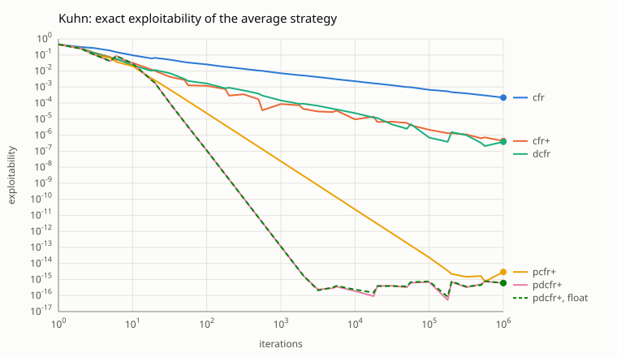

Float and exact best responses agree to three digits down to about 1e-13. Below
that they drift apart (PDCFR+ at 10,000 iterations: 2.36e-16 by the float best
response, 1.88e-16 exactly), but the exact curve flattens in the same place.
From 5,000 to a million iterations PDCFR+ wanders between 5.3e-17 and 7.5e-16
exactly, and PCFR+ flattens between 7.5e-16 and 2.9e-15 after 200,000. The floor is
in the strategy itself, which is accumulated and normalized in doubles, and
not in the float best response that measures it.

## Sealed-bid auctions

`Auction` models first-price, second-price (Vickrey) and all-pay auctions with
private values. Values and bids are the integers 0 to x, each bidder's value is
uniform and independent, and a tie at the top is either split evenly or voids
the sale (the two rules in Rasooly and Gavidia-Calderon's "The importance of
being discrete"). An optional reserve makes every bid below it a pass. These
games are general-sum, so they run on the n-player signature, and every number
below is NashConv.

Building the tree is wasteful here: each bidder only sees their own value, so
the game is a Bayesian game and the expected payoff of bid b for value v has a
closed form. For bidder i, take the other bidders' bid distributions. A
polynomial in z, multiplied out one rival at a time as P(bid < b) + P(bid = b) z,
gives the probability that exactly k rivals tie at b and all others are below.
The share of the item won is then the sum of those coefficients divided by
k + 1 (split ties) or just the k = 0 term (void ties), and every rule fits
u(v, b) = v W(b) - pay(b), with pay(b) = b W(b) for first price, b for all-pay,
and the expected highest rival bid (floored at the reserve) for second price.
That costs O(x n^2) per bidder instead of a tree with (x + 1)^(2n) leaves. The
evaluator is a functor over a field, so the same code runs in floats inside the
solver and in exact rationals for certificates. A regret-matching solver on
top of it follows the full-tree n-player CFR iterate for iterate (tested for
four rules and algorithms), and checks against an explicit tree of the same
game for values and best-response gains.

The discrete theorems come out exactly in rational arithmetic:

- Second price: bidding your value is an exact equilibrium for every tie rule
  and reserve tried, and a best response to random opponents. With two bidders
  the revenue is exactly E[min of two values].
- First price, two bidders, void ties: enumerating every symmetric pure
  strategy with b(v) <= v leaves exactly floor(v/2) and ceil(v/2), for x = 2
  to 7 (their Proposition 2).
- First price, three bidders, void ties: no symmetric pure equilibrium for
  x = 4, 5, 6 (Proposition 3).

CFR+ does find equilibria where the pure search says there are none. With
three bidders and values 0 to 12 under void ties, self-play with one shared
strategy converges to a symmetric mixed equilibrium: values 3, 6, 9 and 12 bid
exactly 2v/3, and the others mix between the two neighbouring bids. Value 4
bids 2 with probability 0.242641, which is 3 sqrt(2) - 4: bidding 2 wins when
both rivals bid 0 or 1 (3 of 13 types each), bidding 3 also beats rivals who
bid 2 (4 + p types), so indifference needs 2 (3/13)^2 = ((4 + p)/13)^2. An
irrational mix like this cannot come out of a rational LP, but the iterate's
exact NashConv, computed in rationals from its doubles, is 9e-16. Run
without the shared strategy, CFR+ instead lands on asymmetric equilibria in
the void-tie games, whose last iterate has an exact NashConv of 0 (two bidders
with values 0 to 10, and three with 0 to 6). With split ties it stalls: on two
bidders and values 0 to 10, the average of CFR+ and DCFR sits near 1.6e-4 of
the top value from 10,000 to 100,000 iterations, and linear and vanilla CFR
near 5e-4. No-regret dynamics only promise a coarse
correlated equilibrium in general-sum games, and here the product of the
marginals is not quite Nash.

```
$ cfr-solver auction --top 12 --bidders 3 --void --symmetric -n 20000 --exact
exact      nash conv of the last iterate 9.122910e-16
           bidder 0, v = 1: 0 w.p. 0.500000, 1 w.p. 0.500000
           bidder 0, v = 4: 2 w.p. 0.242641, 3 w.p. 0.757359
           bidder 0, v = 7: 4 w.p. 0.348469, 5 w.p. 0.651531
           bidder 0, v = 10: 6 w.p. 0.392305, 7 w.p. 0.607695
```

On a grid of 101 values, symmetric CFR+ reproduces the continuous Bayes-Nash
bid functions: (n - 1)/n v for first price, and (n - 1)/n v^n for all-pay.

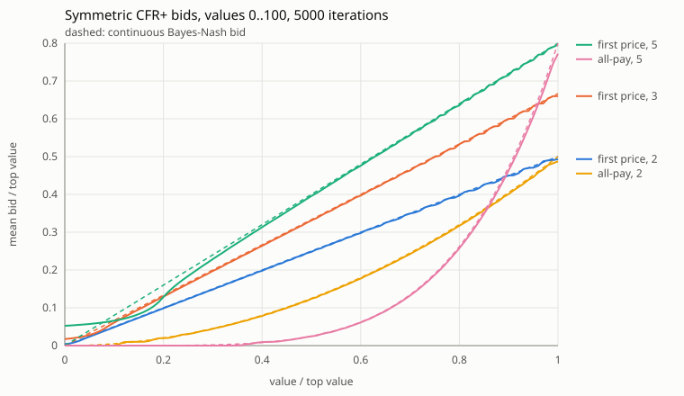

```
$ cfr-solver auction-bids --svg docs/auction-bids.svg
auction           nash conv  error, v>=1/4    revenue     theory
first price, 2     1.20e-04         0.0066     0.3326     0.3333
first price, 3     1.20e-04         0.0067     0.4996     0.5000
first price, 5     1.03e-04         0.0160     0.6669     0.6667
all-pay, 2         1.37e-04         0.0125     0.3309     0.3333
all-pay, 5         3.29e-04         0.0278     0.6655     0.6667
```

NashConv and the bid error are in units of the top value.

The error column is the largest gap between the mean bid and the theory for
values above a quarter of the top. Below that, with five bidders, a value
almost never wins (P(win) is about (v/x)^4), so its bid hardly moves anyone's
payoff and CFR+ leaves it near where it started. Revenue, which is what those
bids add up to, lands on (n - 1)/(n + 1) for all five auctions, the revenue
equivalence theorem showing up in the numbers.

Moving the reserve shows Myerson's optimal auction: for uniform values the
revenue-maximizing reserve is 1/2 whatever the number of bidders, and first
and second price earn the same at every reserve.

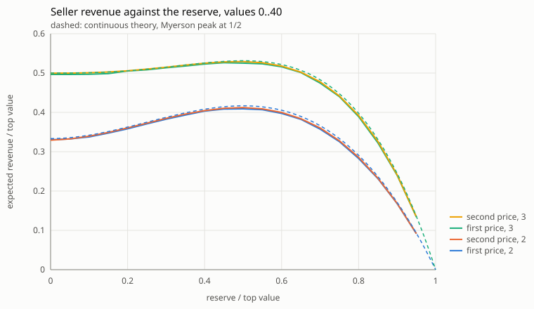

```
$ cfr-solver auction-reserve --svg docs/auction-reserve.svg
first price, 2   best reserve 0.500, revenue 0.4089 (at r = 0: 0.3303)
second price, 2  best reserve 0.500, revenue 0.4121 (at r = 0: 0.3293)
first price, 3   best reserve 0.450, revenue 0.5262 (at r = 0: 0.4964)
second price, 3  best reserve 0.500, revenue 0.5293 (at r = 0: 0.4997)
theory: best reserve 0.5, revenue 0.4167 (n = 2), 0.5312 (n = 3)
```

The continuous curve is 2n/(n + 1) (1 - r^(n+1)) - (1 - r^n), checked against
a Simpson integral of the first-price bid function with a reserve. The
discrete grid of 41 values sits slightly under it, and its peak is flat
enough that three bidders under first price land on 0.45 instead of 0.5.

The solver loop is plain float code over the closed form. Moving the rival
marginals out of the functor (where every float is boxed), caching the current
strategies and replacing a float fold in regret matching with a loop took
5,000 iterations at 101 values from 6.9 s to 1.55 s with two bidders and from
41.6 s to 5.9 s with five, with bit-identical output.

## A market-making game

Trading interviews like "make me a market on the sum of these cards". `Market`
turns that into a two-player zero-sum game small enough to solve exactly. Deal
cards from a deck 1..k without replacement: one to the maker, one to the taker,
and optionally a hidden card that nobody sees but that counts in the sum S. The
maker quotes a market of fixed width w around an integer mid m (bid m - w/2,
ask m + w/2), and the taker, who sees their own card and the quote, buys at the
ask, sells at the bid or passes. With `--rounds 2` the taker then quotes back
and the maker trades, so the second quote can use what the first trade gave
away. Because the game is zero-sum the whole toolkit applies: CFR, the exact
best response, and the sequence-form LP in rationals.

The interesting part is the quote itself. A maker who quotes their fair value
E[S | own card] tells the taker exactly which card they hold. With a deck of
three cards and zero width that maker loses 2/3 per hand (worked out by hand in
the tests), while the equilibrium maker loses 1/3. On a bigger deck the
equilibrium pools almost every card onto two quotes and swaps them on
purpose:

```
$ cfr-solver market --cards 8 --hidden 1 --width 3 -n 2000
market-8h1-w3, 2000 iterations of dcfr in 0.71s
maker value     -0.312245 per hand (nash conv 7.42e-06)
revealing quote -0.482143
uninformed      -0.357143

maker's first quote:
  card  1  fair 11.00  quotes 13:0.74 14:0.26
  card  2  fair 11.71  quotes 14:1.00
  card  3  fair 12.43  quotes 13:1.00
  card  4  fair 13.14  quotes 13:1.00
  card  5  fair 13.86  quotes 14:1.00
  card  6  fair 14.57  quotes 14:1.00
  card  7  fair 15.29  quotes 13:1.00
  card  8  fair 16.00  quotes 13:0.26 14:0.74
```

A 2 quotes high and a 7 quotes low, so seeing 14 tells the taker little about
which side of fair the maker is on. "Uninformed" quotes the middle of the range
whatever the card, and the equilibrium beats it too: the card is worth
something, as long as the quote does not give it away. Without a hidden card
the two often tie exactly: on a six-card deck they agree at widths 1, 2 and 4
to 6, and differ only at width 0 (a loss of 1.1667 against 1.2000) and width 3
(0.1574 against 0.1667).

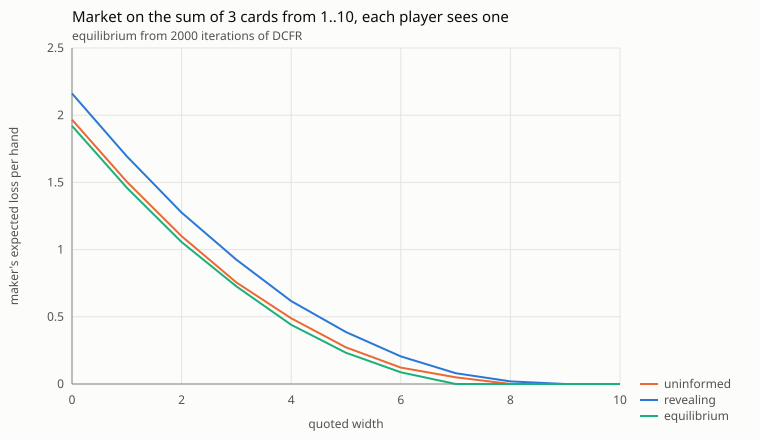

```
$ cfr-solver market-width --cards 10 --hidden 1 --widths 10 -n 2000
width  equilibrium    revealing   uninformed
    0      -1.9202      -2.1611      -1.9667
    1      -1.4603      -1.6944      -1.5056
    2      -1.0558      -1.2750      -1.1000
    3      -0.7263      -0.9250      -0.7556
    4      -0.4408      -0.6167      -0.4889
    5      -0.2318      -0.3861      -0.2722
    6      -0.0870      -0.2056      -0.1222
    7       0.0000      -0.0806      -0.0500
    8       0.0000      -0.0194      -0.0000
    9       0.0000      -0.0000      -0.0000
   10       0.0000      -0.0000      -0.0000
```

The equilibrium maker breaks even from a width of 7, one tick before the
uninformed one and two before the revealing one. Since the taker can always
pass, the maker's value is never positive here; the width is the price of the
taker's information. With `-n 0` the sweep solves the LP exactly instead: the
six-card numbers above are exact, but on eight cards with a hidden card the LP
handled widths 0 to 2 in seconds and then ran for more than nine minutes on
width 3 without finishing, so the larger sweeps use DCFR, whose NashConv after
2,000 iterations is below 1e-5.

## Tuning discounted CFR

DCFR has three knobs: alpha discounts positive regrets, beta negative ones,
and gamma weights the average. `cfr-solver landscape -g GAME -n N` runs every
combination of alpha in {0.5, 1, 1.5, 2, 2.5, 3, 4, inf} and gamma in
{0, ..., 6} for beta = -inf (DCFR+), beta = 0 and beta = 1, plus PDCFR+ over
the same (alpha, gamma) grid, 229 runs in all, spread over OCaml domains.

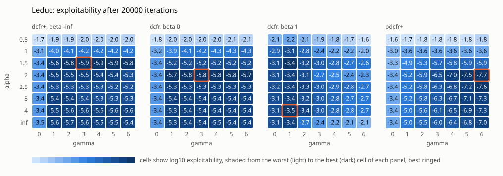

On Leduc after 20,000 iterations (above), both DCFR panels have a flat
valley: every alpha from 1.5 up and every gamma from 1 up lands within a
factor of five of the panel's best cell, 1.3e-6 for DCFR+ at alpha 1.5 and
gamma 3, and 1.5e-6 for beta = 0 at alpha 2 and gamma 3. The defaults sit in
it (DCFR 6.0e-6, DCFR+ 1.3e-6). Two choices are bad in every panel: alpha =
0.5, which discounts positive regrets so hard that the solver keeps
forgetting what it learned, and gamma = 0, a plain average that keeps the
full weight of the first iterations. Keeping negative regrets with beta = 1
costs more than two orders of magnitude (its best cell is 3.2e-4). PDCFR+ is
the one panel with a slope instead of a valley: exploitability keeps falling
as gamma grows, and its best cell, alpha 2 and gamma 6 at 2.0e-8, beats the
paper's (2.3, 5) at 5.1e-8 on this game.

The ranking depends on the budget. After 2,000 iterations the same grid puts
PDCFR+'s best cell (1.4e-4) six times behind the best DCFR cell (2.4e-5);
after 20,000 it is 66 times ahead. On Liar's dice after 1,000 iterations the
DCFR panels win (best 6.3e-5 at alpha 2, beta 0, gamma 2, against 9.2e-5 for
the default) and PDCFR+ gets no better than 3.3e-4. On Kuhn after 1,000
iterations PDCFR+ with alpha at least 2 and gamma 6 is between 8.6e-16 and
4.1e-15, ten orders of magnitude below any DCFR setting. The other two grids
are [docs/landscape-kuhn.svg](docs/landscape-kuhn.svg) and
[docs/landscape-liars.svg](docs/landscape-liars.svg), with the numbers in
the CSV files next to them.

## Parallel Monte Carlo CFR

External sampling looks embarrassingly parallel: given the regrets, every
traversal is independent. The catch is that the regrets are what every
traversal reads. `Parallel.Make (G)` runs MCCFR on several OCaml 5 domains in
one of two modes.

**Shared tables** (the default). Every domain reads and writes one regret
table with no locks, the way multithreaded blueprint solvers do it. Two domains
can update the same regret at the same moment and one increment gets lost. In
OCaml 5 that is a data race with defined behaviour (no torn floats, no memory
unsafety), and on Leduc it costs nothing measurable. Strategy sums never feed
back into play, so they are not shared: each domain accumulates its own and
they are added up when the run ends, the way per-CPU counters work. That halved
the writes to shared cache lines and took 8 domains from 0.67 s to 0.54 s on a
4-million-iteration run. With more than one domain the result is not
reproducible.

**Private tables** (`--private`). Each domain runs `--batch` iterations on its
own copy of the tables, then the domains meet at a barrier and merge,
`master += sum_j (table_j - master)`, each domain merging its own stripe of
slots, and everyone copies the master back. The result is deterministic for a
given seed, domain count, batch and sequence of `run` calls, and nothing races.
The price is staleness: a domain plays a strategy that has not seen the other
domains' last batch, and regret matching on stale regrets converges more slowly
(the regret bound grows with the square root of the delay).

```
$ cfr-solver scale -g leduc -n 4000000 --svg docs/scale.svg
```

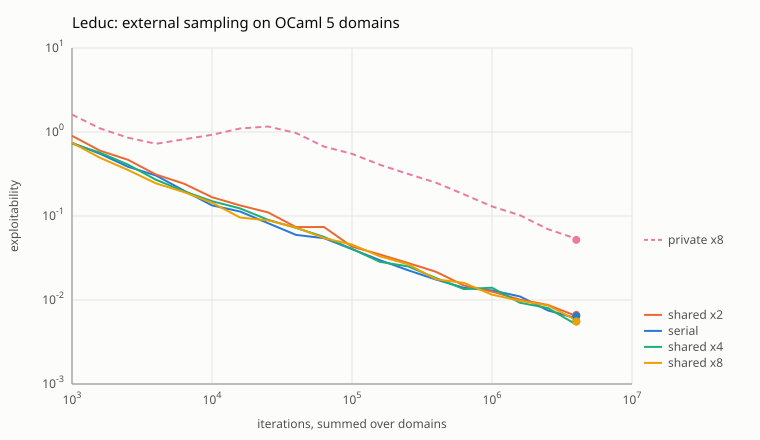

The chart counts iterations summed over domains, so a mode that loses nothing
to parallelism sits on the serial line. The shared runs do. Private tables on 8
domains with batches of 1,000 end 8 times more exploitable after the same 4
million iterations.

Wall time for those 4 million iterations, one uninterrupted run each, on a
Ryzen 7 7800X3D (8 cores, 16 threads) under Windows. The first pair of columns
pins the process to one logical CPU per core (`start /affinity 5555`), the
second lets Windows schedule it.

| config      | pinned (s) | speedup | default (s) | speedup | exploitability |
|-------------|-----------:|--------:|------------:|--------:|---------------:|
| serial      | 2.25       | 1.00    | 2.25        | 1.00    | 6.44e-3        |
| shared x2   | 1.30       | 1.73    | 1.37        | 1.64    | 6.14e-3        |
| shared x4   | 0.75       | 2.99    | 1.00        | 2.25    | 7.02e-3        |
| shared x8   | 0.47       | 4.75    | 0.61        | 3.68    | 8.09e-3        |
| private x8  | 0.33       | 6.83    | 0.56        | 4.00    | 5.45e-2        |

Shared tables flatten out past 4 domains because Leduc's whole regret table is
672 floats (5.4 KB) and every domain writes all of it, so the cores spend their time
passing cache lines back and forth. Private tables scale almost linearly and
give it all back in staleness. On a game this small, shared tables win at any
fixed wall time. Unpinned, Windows often puts two domains on the two threads of
one core: fully independent solvers with no shared data at all hit the same
ceiling (1.6x on 2 domains), so that part is the scheduler, not the solver.

Two fixes came before any of this scaled. `Random.State` keeps its state in a
32-byte bigarray allocated with `malloc`, so two domains' generators can land
on one cache line, and two domains drawing random numbers ran 3 times slower
than one. The solver now uses its own SplitMix64 (`lib/rng.ml`) with the state
in a 64-byte `Bytes` that each domain allocates for itself. And one tuple
allocated per iteration was enough to stall every domain, because OCaml 5
minor collections stop the world. The walks and the iteration loop allocate
nothing now.

The domains are spawned once. `lib/pool.ml` keeps worker domains parked on a
condition variable between calls; `Parallel.run` hands every worker the same
job, runs its own share on the calling domain and waits for the rest. Worker j
is always the same domain, so the tables it allocated on its first run stay
where they are. Before the pool, every `run` call spawned and joined its
domains. Splitting 4 million iterations into 400 calls on 8 domains
(`dune exec ./bench/bench.exe`) cost 15.9 ms a call before and 1.9 ms after,
and about 1.6 ms of that is the work itself.

## Weighted Monte Carlo CFR

`-w lcfr`, `-w dcfr` and `-w cfr+` apply the full-tree discounts to the sampled
solvers once every `--batch` iterations (discounting per interval of
iterations is how Pluribus did it). On Leduc it mostly hurts. Mean
exploitability of external sampling over 8 seeds, discounting every iteration:

| iterations | none   | lcfr   | dcfr   | cfr+   |
|-----------:|-------:|-------:|-------:|-------:|
| 1,000      | 0.759  | 0.597  | 0.677  | 0.717  |
| 10,000     | 0.158  | 0.140  | 0.195  | 0.193  |
| 100,000    | 0.0467 | 0.0481 | 0.0634 | 0.0626 |
| 1,000,000  | 0.0129 | 0.0150 | 0.0207 | 0.0207 |

Linear weighting helps early and the advantage is gone by 100,000 iterations.
DCFR and CFR+ end 60% worse. Both cut negative regrets (DCFR halves them, CFR+
zeroes them), and with sampled regrets that is not neutral: a noisy negative
estimate gets cut while a noisy positive one is kept, so the regrets drift
upward. Discounting only the first 10,000 or 100,000 iterations, as Pluribus
did early in training, came out the same as no discounting at 1 million.
Outcome sampling shows the same pattern.

## Card abstraction

Real poker has too many hands to give each its own strategy, so solvers group
hands into buckets and solve the smaller game. How much that costs is usually
hard to know, because the real game is too big to evaluate. Here it isn't.
`Leduc.game` takes any deck, and with 13 ranks and two suits (`leduc13`, 26
cards, 166,349 histories, 5,148 infosets) the hands differ enough for buckets
to matter while an exact best response takes 0.2 s. An
abstraction is a function from a player's private card (and the board) to a
label. `Leduc.game ~abstraction` builds the abstract game over the same
histories, CFR+ solves it, `Abstraction.Make (Full) (Abs)` maps every real
infoset to its abstract one and lifts the strategy back, and the exploitability
is measured in the full game.

The features come from hand strength: HS(c, b) is the chance that card c beats
a random opponent card on board b, ties counting half. Before the board is
dealt the strength is a distribution, which the solver summarizes three ways:
its mean E[HS], its second moment E[HS^2] (which rewards hands whose strength
can still swing up), or the whole distribution as a 20-bin histogram. Scalar
features are bucketed by exact 1D k-means: on sorted values the clusters are
contiguous runs, so a dynamic program over split points finds the optimal
partition in O(k n^2). Histograms are clustered by k-medians under earth
mover's distance with k-means++ seeding. In one dimension EMD is the L1
distance between the two CDFs, so the best center of a cluster is the
pointwise weighted median of its members' CDFs (itself a valid CDF), and every
Lloyd step can only lower the cost.

```
$ cfr-solver abstract -n 4000 --csv docs/abstraction.csv --svg docs/abstraction.svg
leduc13: 4000 iterations of cfr+ per abstraction, 44 jobs in 112.5 s
```

The 44 abstract games run side by side on the domain pool. The exact game
after the same 4,000 iterations is at 3.1e-5, so everything above that is the
abstraction.

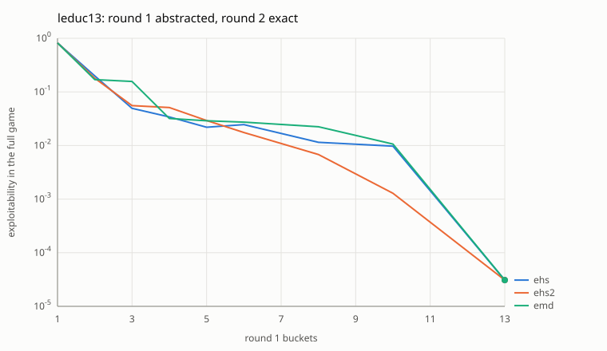

| round 1 buckets | 1     | 2     | 3      | 4      | 5      | 6      | 8       | 10      |
|-----------------|------:|------:|-------:|-------:|-------:|-------:|--------:|--------:|
| E[HS]           | 0.821 | 0.198 | 0.0493 | 0.0341 | 0.0219 | 0.0246 | 0.0115  | 0.0097  |
| E[HS^2]         | 0.821 | 0.180 | 0.0555 | 0.0511 | 0.0292 | 0.0175 | 0.0068  | 0.0013  |
| EMD histogram   | 0.821 | 0.170 | 0.157  | 0.0320 | 0.0290 | 0.0272 | 0.0223  | 0.0106  |

Here round 2 keeps the exact card and board. Playing the first round blind
costs 0.82 chips a hand; three E[HS] buckets bring it down to 0.049. No feature wins
everywhere. The histograms are best at 2 and 4 buckets, E[HS^2] from 6 on, and
at 10 buckets it is 7 to 8 times better than the other two. More buckets is not always
better either: E[HS] gets worse from 5 to 6. The two partitions aren't nested,
so this isn't quite the refinement pathology of Waugh et al. (2009), but it is
the same warning. The histograms have less to work with than in hold'em: every
card has the same spike of mass 1/25 at HS = 1 (pairing the board), and
otherwise only two strengths, board above or below the card.

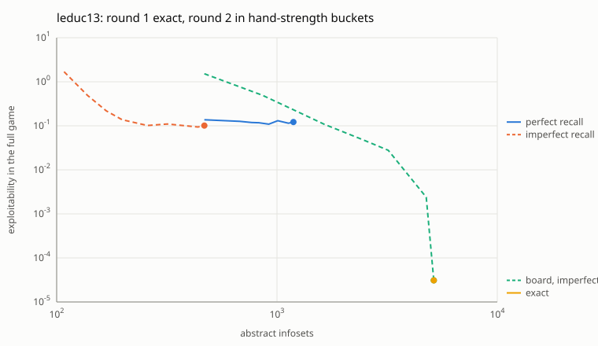

The second chart keeps round 1 exact and buckets round 2 by HS. With perfect
recall the key is the card plus the bucket; with imperfect recall the player
forgets the card and keeps only the bucket (and the betting). Hand strength
alone stalls at about 0.1 however many buckets it gets, because on leduc13 it
takes only 13 values: card c with the board above it has HS (2c + 0.5)/24,
exactly the same as card c + 1 with the board below it. Those are different
spots (in the second the opponent can pair the board), and no bucketing of HS
can tell them apart. Forgetting the card is cheap by comparison: imperfect
recall reaches 0.094 with 438 infosets, better than any perfect-recall version
up to 1,188 (best 0.109), which matches what Johanson et al. (2013) found in
hold'em. Keeping the public board in the key and bucketing only the private
card removes the floor and reaches the exact game at 13 buckets. CFR+ has no
convergence guarantee with imperfect recall, so I also ran 1,000 iterations:
the round 2 values moved by up to 20%, and imperfect recall still came out
ahead of perfect recall.

## Hand evaluator

`Hand.eval` scores 5 to 7 hold'em cards as one int where higher wins: the
category in the top bits, then up to five ranks in 4-bit fields. It builds a
13-bit rank mask per suit and four masks for ranks seen once, twice, three and
four times (each card ORs into the next mask up), and reads popcounts, top
bits and straights from 8,192-entry tables. The tests enumerate all 2,598,960
five-card hands and get the textbook category counts (40 straight flushes, 624
quads, and so on up to 1,302,540 high cards) and 7,462 distinct values, and a
qcheck property checks that seven cards score the best of their 21 five-card
subsets. The bench enumerates all 133,784,560 seven-card hands, checks the
published counts and 4,824 distinct values, and exits non-zero if anything is
off. It does 41 million hands a second on one core, up from 14 million when
popcount and the top bit were recursive functions.

## Hold'em subgames

`cfr-solver subgame` solves a heads-up spot from the river or the turn: a
board, a pot, a range for each player and a betting tree. With both ranges
random there are 1,081 hands each on a river, so walking one history per deal
the way `Cfr.Make` does would mean 1,081^2 deals through every node. The
subgame solver works on the public tree instead (Johanson et al. 2011, 2012):
one node per betting sequence, and at each node a vector with one regret per
hand of the player to act. A walk carries one reach vector per player and
returns one value per hand, so an iteration touches every node once.

```
$ cfr-solver subgame --board "Qs Jh 8d 5c 2s" --pot 6 --limit 1 -n 1000
river Qs Jh 8d 5c 2s, pot 6, limit 1, cap 4
oop 1081 hands, ip 1081 hands, 10 decision nodes

exploitability, % of the pot
iterations      dcfr
         1 2.923e+01
        10 1.286e+00
       100 3.290e-02
      1000 1.333e-03
  time (s)      0.61

dcfr strategy, oop value -0.0822 (pot 6)
  oop -             x 0.569  b1 0.431
  ip  x             x 0.356  b1 0.644
  oop xb1           f 0.181  c 0.667  b2 0.152
  ip  xb1b2         f 0.232  c 0.618  b3 0.150
  oop xb1b2b3       f 0.180  c 0.597  b4 0.223
  ip  xb1b2b3b4     f 0.155  c 0.845
  ip  b1            f 0.162  c 0.598  b2 0.240
  oop b1b2          f 0.234  c 0.617  b3 0.149
  ip  b1b2b3        f 0.176  c 0.610  b4 0.214
  oop b1b2b3b4      f 0.142  c 0.858
```

That is fixed-limit betting with a pot of 6 and bets of 1, both ranges
random, and DCFR. The table is trimmed to every tenfold; the real one prints
four checkpoints per decade. Each row of the strategy is a public node with the actions' frequencies weighted by how often
each hand gets there, so `xb1b2` is the second player facing a check-raise.
With identical ranges the first player loses 0.08 chips a hand to position.
`--oop` and `--ip` take ranges like `TT+, AQs+, KQ, QJs:0.5`, `--json` writes
the strategy of every hand at every node, and `-a cfr,cfr+,lcfr,dcfr` runs
several algorithms side by side:

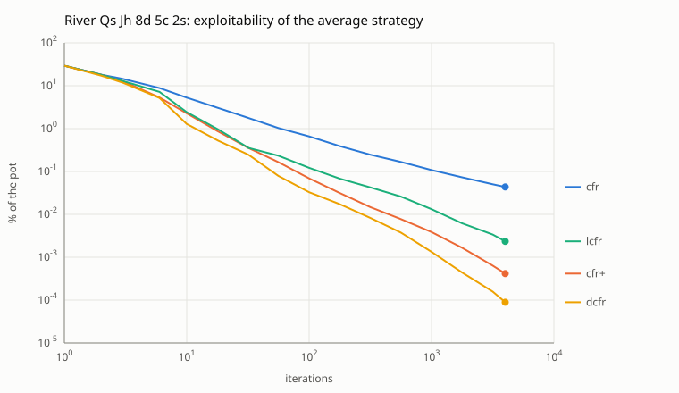

After 4,000 iterations, as a share of the pot: CFR 4.4e-2%, linear CFR
2.3e-3%, CFR+ 4.2e-4% and DCFR 8.9e-5%. The ranking matches Leduc except
that DCFR finishes ahead of CFR+ here.

**Showdowns in O(n).** At a showdown each of my hands is worth
`win x (opponent reach below me - opponent reach above me)`, counting only
opponent hands that share no card with mine. Both players' hands are sorted by
strength once per board, so one sweep up and one sweep down give the two sums
for every hand. Card removal is inclusion-exclusion: while sweeping, keep the
total reach and the reach per card (52 floats), and a hand with cards a and b
subtracts the mass on a and on b. A fold is the same without the sort, plus the
reach of the identical combo, which got subtracted twice. Done naively that is
1,081^2 comparisons per showdown.

**The turn.** A turn subgame deals the river as a chance node: 48 cards, each
with its own copy of the river tree and its own sorted order. In a child, hands
holding that card get zero reach, and a hand's value is the average over the 44
river cards it doesn't block (52 minus 4 board cards minus 4 hole cards). With
fixed-limit betting that is 4,330 decision nodes. An iteration takes 0.28 s with random ranges,
and the solve peaks at 523 MB.

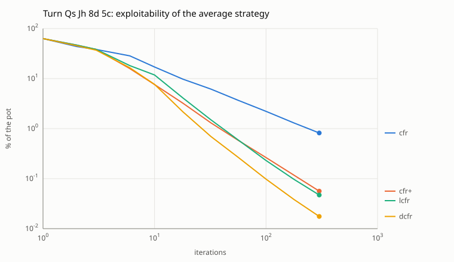

After 300 iterations: CFR 0.82% of the pot, CFR+ 0.056%, linear CFR 0.047%
and DCFR 0.018%. Linear CFR, which stalled on Leduc, catches CFR+ here.

**Speed.** `dune exec ./bench/bench.exe` times DCFR iterations with both ranges
random (Ryzen 7 7800X3D, one core). The first version took 0.87 ms per river
iteration and 401 ms per turn iteration. Building with `-unsafe` cut 27%, so
bounds checks were most of the overhead. The inner loops of `lib/subgame.ml`
now use unchecked index operators, `a.!(i)` for float arrays and `a.%(i)` for
int arrays, declared as `external` so the compiler keeps the unboxed float
array access, and the rest of the library stays checked. With the loop
invariants hoisted it runs 0.59 ms on the river and 277 ms on the turn, 32%
and 31% faster. Every index in those loops is a hand below the side's count or
a card below 52 by construction, and the test suite passes unchanged.

## Making the turn smaller

A turn tree is 44 to 48 copies of a river tree, and with random ranges its
regrets and strategy sums take 203 MB in doubles. Three things cut that down,
and one more trades exactness for size on purpose.

**Suit isomorphism.** On Ks 9s 5s 2s nothing distinguishes hearts, diamonds and
clubs, so the 7h river and the 7d river are the same game with two suits
renamed, as long as both ranges treat the suits alike too. The solver finds the
suit permutations that fix the board and both ranges' weights (6 here, 2 on a
two-tone board like Ks 9s 5d 2d, only the identity on a rainbow board or with a
random-weighted range), solves one river per class of cards and maps the
values of each other river card back through the permutation. On a monotone
turn that is 22 river trees instead of 48:

| Ks 9s 5s 2s, both ranges random | decision nodes | regrets + sums | ms per iteration |
|---------------------------------|---------------:|---------------:|-----------------:|
| every river card                | 4,330          | 203.2 MB       | 241              |
| one card per suit class         | 1,990          | 93.4 MB        | 126              |
| same, 32-bit floats             | 1,990          | 46.7 MB        | 127              |

Copying values is only exact if the strategies above the chance node are
symmetric too, so that the reach coming into the 7h river is the 7d river's
with suits swapped. In exact arithmetic CFR keeps a symmetric start symmetric,
but floating point doesn't: without folding, on Ks 9s 5s 2s with real ranges,
two hands that differ only by a heart/diamond swap drift apart from 4e-16 after
one iteration to 0.01 after five, and from the second iteration on the folded
and unfolded runs disagree completely at a node where the regrets tie. So the solver ties them: after
each regret update, hands in the same orbit get the orbit's mean regret (and
are left alone when they already agree, because (x + x + x) / 3 does not always
round back to x). That makes it CFR on the game where symmetric hands share a
strategy, which by symmetry still contains an equilibrium of the real game.
Postflop-solver folds the same way but only swaps the values, relying on the
reach being symmetric. The tests solve the same spots folded and unfolded
(turn, and a flop with two nested chance levels) and compare every hand's
strategy at every real node, river cards included, to 1e-9.

**32-bit floats.** `--single` stores regrets and strategy sums in float32
bigarrays, half the memory for 1 to 4% more time per iteration. The walk
still computes in doubles. After two iterations the strategies match the
double run to 3e-8, but the runs then drift apart wherever a hand is
indifferent between actions, the same tie amplification as above. They are
different trajectories with the same exploitability (within 1% after 30
iterations, and after 100 the float32 run happened to be lower).

**Skipping dead subtrees.** In an alternating pass the walk only needs values
for the player being updated, and those values are linear in the opponent's
reach. When no opponent hand reaches a node with positive probability every
value below it is zero and no regret can change, so the walk skips it and only
adds the updating player's strategy sums on the way down. The result is bit
for bit the same as without skipping (tested over 40 iterations of CFR+ and
DCFR, regrets, averages and best responses). It helps less than I hoped: with
real ranges on Qs Jh 8d 5c it skips about 530 subtrees per iteration and goes
from 19.9 to 17.9 ms an iteration, and with random ranges almost every line has
some hand that reaches it.

**Regret-based pruning.** `-a cfr-rbp` and `-a lcfr-rbp` add interval
regret-based pruning (Brown and Sandholm, NeurIPS 2015) to vanilla and linear
CFR. Skipping dead subtrees only drops lines the opponent never reaches. RBP
also drops lines the updating player never takes: when every hand has a
negative regret on an action and some other action positive, regret matching
plays it with probability zero, nothing below it can affect anyone, and the
walk can leave it alone until its regret could have turned positive. Each
iteration the solver checks that with a bound. For every hand, the action's
regret plus, over the skipped iterations, the most the hand could have won
below the action minus what it got at the node, has to stay at or below zero.
The most a hand can win is a sum over the opponent hands that reach the node:
the largest payoff in the subtree when a card is still to come, and when none
is, the most it can take from that particular hand (the biggest showdown pot
from a hand it beats, the biggest fold from a hand it loses to).

While an action is pruned the solver keeps three running sums: the opponent's
reach, the node's value and the bound. When the bound fails, one walk with the
summed reach catches up every skipped iteration at once, playing a best
response below the action, which is what keeps CFR's regret bound in the
paper. One walk is enough because everything below a pruned action is frozen
for the whole window: the player never goes there, so the opponent's regrets
below can't change either, and the values below are linear in the opponent's
reach at the top. The opponent's strategy sums below are deferred the same
way and added before anything reads the averages. Linear CFR multiplies every
regret by the same factor, which folds into the sums as a running scale. CFR+
and DCFR treat negative regrets differently from positive ones, so the solver
refuses RBP with them.

It works, and on these spots it saves between nothing and 11% of the time:

```
$ cfr-solver subgame --board "Qs Jh 8d 5c" --pot 10 --stack 50 --cap 2 \
    --oop "TT+, AQ+, KQs, QJs, JTs, T9s, 98s" --ip "88+, AJ+, KQ, QJs, JTs, A5s" \
    --bets 0.33,0.75,1.5 --all-in -a cfr,cfr-rbp,lcfr,lcfr-rbp -n 1000
```

| spot (vanilla CFR unless noted)                        | pruned/it | plain  | RBP    | exploitability, plain / RBP |
|--------------------------------------------------------|----------:|-------:|-------:|----------------------------:|
| limit turn Qs Jh 8d 5c, real ranges, 2,000 it          | 320       | 26.4 s | 23.4 s | 0.194% / 0.199%             |
| no-limit turn above, 1,000 it                          | 383       | 22.3 s | 20.8 s | 2.64% / 2.60%               |
| no-limit turn above, linear CFR, 1,000 it              | 293       | 31.1 s | 31.4 s | 0.111% / 0.120%             |
| no-limit river Qs Jh 8d 5c 2s, random ranges, 3,000 it | 2.1       | 4.10 s | 4.54 s | 0.501% / 0.493%             |

The limit turn alternated the two solvers in blocks of 100 iterations, which
is the only way I found to get stable numbers on this machine: from about
iteration 400 on, every block with pruning was faster, 13.0 against 11.2 ms an
iteration by the end. The no-limit turn ran back to back, twice; the other run
gave 23.8 against 21.5 s for CFR and 35.7 against 34.2 s for linear CFR, so
the linear CFR difference is noise.

In vector form an action can only be pruned when the whole range has given it
up, so a window lasts as long as the hand closest to taking the action again: about 4 iterations over the first 512 on the no-limit turn, and
on a small no-limit river 7 at 1,000 iterations and 21 at 16,000. Most of what
gets pruned is small river subtrees, where the bound costs about as much as
the walk it saves. The paper's order-of-magnitude speedups are for scalar CFR,
where every infoset is one hand and gets its own window. The exploitability
curves track the plain runs within 20% either way the whole time.

**Hand-strength buckets.** `cfr-solver buckets` merges hands into buckets
inside the solver itself: on the turn by E[HS^2] (the mean over river cards of
squared hand strength against a random hand), on each river by hand strength,
both clustered with the optimal 1D k-means from the Leduc experiments. Hands in
a bucket share one regret and one strategy-sum entry, but the tree, the
showdowns and the best response stay per hand, so the exploitability printed is
the exact one in the full turn tree. Nothing has to be lifted.

```
$ cfr-solver buckets --board "Qs Jh 8d 5c" --pot 4 --limit 1 -n 300 \
    --oop "22+, A2s+, K9s+, QTs+, JTs, T9s, 98s, A9o+, KTo+, QJo" \
    --ip "22+, A2+, K5+, Q8+, J8+, T8+, 97s+, 86s+, 75s+" \
    --sizes 2,4,8,16,32,64,128 --svg docs/buckets.svg
```

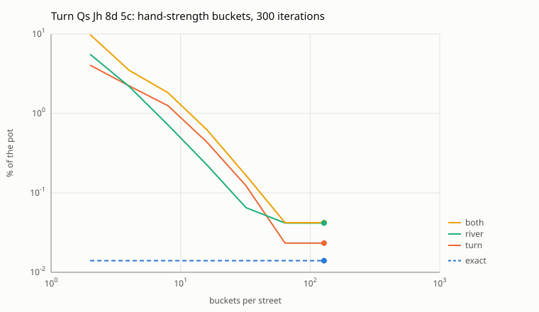

230 hands against 477, 300 DCFR iterations each, exploitability as a share of
the pot:

| buckets | turn only | river only | both    | MB (river only) |
|--------:|----------:|-----------:|--------:|----------------:|
| exact   | 1.40e-2   | 1.40e-2    | 1.40e-2 | 63.7            |
| 2       | 4.05      | 5.57       | 9.85    | 0.51            |
| 8       | 1.25      | 7.15e-1    | 1.82    | 1.58            |
| 32      | 1.23e-1   | 6.51e-2    | 1.66e-1 | 5.74            |
| 64      | 2.33e-2   | 4.17e-2    | 4.22e-2 | 6.73            |

The memory is all on the river: 44 river trees against one turn street, so
bucketing the turn saves nothing and only costs accuracy. River buckets are
the trade worth making, 64 buckets for a tenth of the memory at three times
the exact solve's exploitability (still 0.04% of the pot). Past 64 nothing
changes, because k-means stops at the number of distinct values: on a rainbow
turn no flush is possible, so hands that differ only in suits get the same
strength and share a bucket whatever k is. River and both coincide there on
the chart.

Merging hands raises a weighting question that perfect recall hides. The
regret of a bucket is the sum of its hands' counterfactual regrets, and each
hand's has to be weighted by the probability of being dealt it, its range
weight; summing the vector values unweighted fails the test against the scalar
solver. The tests write the same bucketed game as a `Game.S` whose infoset
keys are bucket labels and check that `Cfr.Make`'s current strategy matches
the vector solver's at every hand and node, for turn buckets, river buckets
and both, under CFR, CFR+ and DCFR. They compare current strategies rather
than averages on purpose: `Cfr.Make` adds to the strategy sum once per
history, which under imperfect recall overweights hands that have more
compatible opponent hands. The vector solver weights each hand by its reach
including the deal, the way a chance-sampled CFR would in expectation.

**Distribution-aware turn buckets.** E[HS^2] squeezes a hand's 46 possible
river outcomes into one number, and very different hands land on the same
one. On Qs Jh 8s 5c, 7s6s (a flush draw and an open-ended straight draw) and
Ac5s (a weak pair) both have E[HS^2] = 0.330. The draw's median river strength
is 0.108 and about a quarter of its rivers give it 0.946 or more; the pair sits
between 0.454 and 0.619 on half its rivers. The two distributions are 0.27
apart in EMD. Johanson et al. (AAMAS 2013) cluster hands on histograms of
their next-street strength under the earth mover's distance instead, and
Ganzfried and Sandholm (AAAI 2014) go one step further and build the histogram
over the next street's clusters, with the distance between clusters as the
ground distance.

`--features` picks the turn feature:

- `ehs2`: E[HS^2] with optimal 1D k-means, as before.
- `histN`: the river hand strength in N equal bins, k-medians under EMD (the
  same code as the Leduc experiments).
- `emd`: no bins. Every hand has exactly 46 equally likely rivers, so its
  distribution is 46 sorted numbers, its quantile function. In one dimension
  EMD (Wasserstein-1) is the integral of |F^-1 - G^-1|, so it becomes the mean
  absolute difference of the sorted vectors, an L1 distance, and the
  coordinate-wise weighted median of sorted vectors is again sorted. k-medians
  in that space is exact EMD k-medians with no rounding into bins.
- `potN`: each river's hands are first split into N clusters by optimal 1D
  k-means on hand strength (the squared-L2 equity clustering these papers use
  on the last street), every river value is replaced by its cluster's mean,
  and then the same quantile k-medians runs. With one-dimensional river
  clusters the ground distance between two of them is the distance between
  their means, so this is exactly the potential-aware EMD.

Identical distributions are merged before clustering and weighted by their
count, which takes a full turn range of 1,128 hands down to 86 points on Qs
Jh 8d 5c and 274 on Qs Jh 8s 5c, and the clustering to well under a second. It also guarantees that two
hands with the same distribution share a bucket. That turned up a small bug:
E[HS^2] summed over the rivers in deck order gave two hands with identical
distributions values that differ in the last bit, so on Qs Jh 8d 5c there were
87 distinct E[HS^2] values for 86 distinct distributions and k-means could
split them. It is now summed over the sorted distribution. None of the numbers
in the table above moved.

```
$ cfr-solver buckets --board "Qs Jh 8s 5c" --pot 4 --limit 1 -n 300 \
    --oop "22+, A2s+, K9s+, QTs+, JTs, T9s, 98s, A9o+, KTo+, QJo" \
    --ip "22+, A2+, K5+, Q8+, J8+, T8+, 97s+, 86s+, 75s+" \
    --sizes 2,4,8,16,32,64 --features ehs2,hist50,emd,pot8 --turn-only \
    --svg docs/turn-buckets-twotone.svg
```

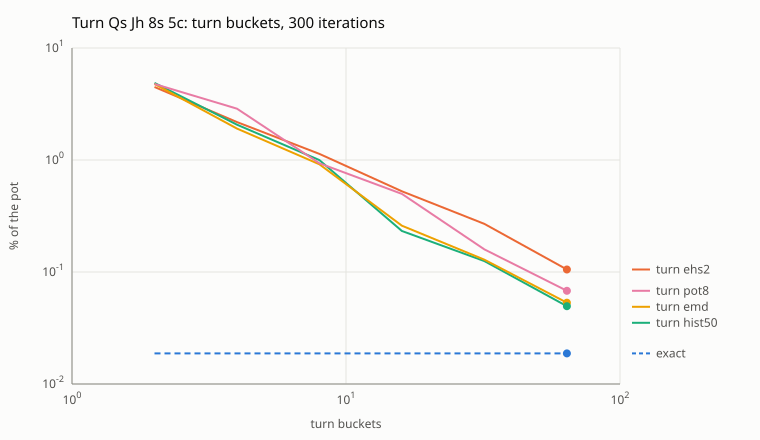

Turn buckets only, rivers exact, same ranges and 300 DCFR iterations,
exploitability in the exact tree as a share of the pot. The exact solve is at
0.0140% on the rainbow turn and 0.0188% on the two-tone one.

| buckets | rainbow ehs2 | hist50 | emd    | pot8   | two-tone ehs2 | hist50 | emd    | pot8   |
|--------:|-------------:|-------:|-------:|-------:|--------------:|-------:|-------:|-------:|
| 2       | 4.05         | 5.02   | 5.02   | 5.02   | 4.49          | 4.88   | 4.77   | 4.77   |
| 4       | 2.22         | 2.04   | 1.49   | 2.93   | 2.18          | 2.07   | 1.91   | 2.87   |
| 8       | 1.25         | 0.818  | 0.790  | 0.849  | 1.13          | 0.998  | 0.916  | 0.935  |
| 16      | 0.434        | 0.218  | 0.233  | 0.406  | 0.525         | 0.232  | 0.259  | 0.499  |
| 32      | 0.123        | 0.0556 | 0.0424 | 0.0550 | 0.269         | 0.125  | 0.129  | 0.159  |
| 64      | 0.0233       | 0.0348 | 0.0233 | 0.0255 | 0.105         | 0.0496 | 0.0533 | 0.0679 |

From 4 to 32 buckets, exact EMD and the 50-bin histograms beat E[HS^2] on
both boards, by about 2x at 16 and 32 buckets, and on the two-tone turn, where
flush draws make the distributions bimodal, the 2x gap is still there at 64.
With 2 buckets E[HS^2] is better, as it was in Leduc; my guess is that a single
split should go by expected strength, and EMD spends it on shape. Exact EMD
and 50 bins trade places: EMD is ahead at 7 of the 12 sizes, so the bins cost
a little but not much. Eight river clusters give up part of the gain at 4 and
16 buckets, which fits rounding river strength to 8 values before the turn
clustering sees it. On the rainbow turn the features nearly meet at 64, since
the whole range there has only 86 distinct distributions. The rainbow chart is
`docs/turn-buckets.svg`.

## Bet sizes and action translation

No-limit trees are built from bet sizes as fractions of the pot, raise sizes as
fractions of the pot after calling, an optional all-in, a cap on bets per
street and the effective stack (`lib/bet_tree.ml`). Sizes that would exceed the
stack become all-in and duplicates merge, so `--stack 35 --bets 0.5,1` in a
pot of 10 gives a 10-chip bet one raise, to all-in, because a pot raise to 40
gets clamped.

Every tree is an abstraction of a game where any size is allowed, and a solver
has to answer sizes it never planned for. Action translation maps an off-tree
bet x (as a fraction of the pot) onto the nearest sizes A < x < B in the tree,
going to A with probability f(x). Three mappings:

- nearest: whichever of A and B is closer,
- arithmetic: f = (B - x) / (B - A),
- pseudo-harmonic (Ganzfried and Sandholm, 2013):
  f = (B - x)(1 + A) / ((B - A)(1 + x)).

The pseudo-harmonic one comes from a toy game where the caller should call a
bet of x with probability 1 / (1 + x). Mixing the right calling frequencies at
A and B with weight f gives exactly 1 / (1 + x), and the tests check that
identity on a grid.

`cfr-solver translate` solves a river with bets of half pot and pot, then for
each x builds the tree where either player may also bet x, translates the
strategy into it and measures its exploitability there.

```
$ cfr-solver translate --board "Qs Jh 8d 5c 2s" --pot 10 --stack 100 -n 2000 \
    --grid 0.25,2,0.025 --svg docs/translation.svg
```

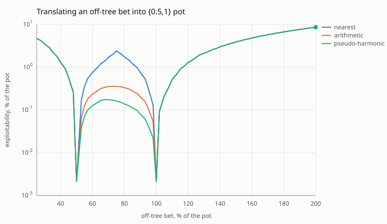

Both ranges are random and the solved tree is at 0.0021% of the pot. Between
the two sizes, pseudo-harmonic peaks at 0.17% of the pot (x = 0.675),
arithmetic at 0.36% and nearest at 2.4% (x = 0.75, where it switches from
calling like a half-pot bet to calling like a pot bet). Outside [0.5, 1] every
mapping sends x to the nearest size and the curves coincide; an overbet of 2
pots costs 8.5% of the pot, which is what not having a large size in the tree
costs.

Translating is more than renaming nodes. Under a randomized mapping the
translated player draws A or B once and then plays that subtree, and the
behaviour that matches is a mixture weighted by that player's own reach in
each subtree, not the plain average of the two strategies: mixing has to
happen on realization plans, and turning the mixture back into a behaviour
strategy brings in the reach. `Subgame.translate` carries one list of belief
nodes per player.
The player who acted follows the abstract action they took, and the other
player follows the mapping. A test checks that the game value is linear in f
for a fixed opponent, which only holds with the reach weights. Stacks get in
the way too: after a 0.75 bet the pot-sized re-raise is clamped to all-in, but
after a 0.5 bet it isn't, so an abstract action can be missing from the real
tree. Then the player bets the closest legal size, or calls if no bet is left,
the way a bot playing a translated strategy would.

`cfr-solver betsizes` asks which sizes to keep. The full tree here has bets of
0.25, 0.33, 0.5, 0.75, 1, 1.5 and 2 pots for both players (44 decision nodes).
Each abstraction is solved on its own with 2,000 DCFR iterations, then
translated pseudo-harmonically into the full tree:

| bet sizes (pot)      | decisions | oop value | own tree (% pot) | full tree (% pot) |
|----------------------|----------:|----------:|-----------------:|------------------:|
| 1                    | 8         | -0.3556   | 9.7e-4           | 20.9              |
| 0.5                  | 8         | -0.2866   | 1.1e-3           | 27.1              |
| 0.5, 1               | 14        | -0.3163   | 2.1e-3           | 13.3              |
| 0.33, 0.75           | 14        | -0.2849   | 1.3e-3           | 15.4              |
| 0.33, 0.75, 1.5      | 20        | -0.2962   | 2.0e-3           | 2.99              |
| 0.25, 0.5, 1, 2      | 26        | -0.2922   | 2.2e-3           | 0.26              |
| all seven            | 44        | -0.2940   | 2.8e-3           | 2.8e-3            |

The largest size decides it. Every abstraction without an overbet loses more
than 13% of the pot in the full tree, because a 2-pot bet gets answered like a
pot bet. Adding 1.5 cuts that to 3%, and 0.25, 0.5, 1 and 2 cuts it to 0.26%
with 26 decision nodes instead of 44. The value column barely moves (the pot is
10, so -0.29 is about 3% of it), which is why picking sizes by value alone
would miss this.

## Re-solving the river

A turn solve can be a blueprint: a strategy computed ahead of time, maybe in
an abstraction, that gets refined once the river card is known. Fixing the
blueprint everywhere except one river subtree and solving that subtree again
from the ranges that reach it sounds safe, but it is not. The new river
strategy is an equilibrium of the river given those ranges, and the opponent
is free to reach the river with a different range once our river play
changes. Burch, Johanson and Bowling ("Solving Imperfect Information Games
Using Decomposition", AAAI 2014) fix this with a gadget: before the river
starts, each opponent hand may take a fixed payoff instead of playing, namely
its counterfactual best-response value against the blueprint on that river.
At an equilibrium of that game no opponent hand gains anything from the new
strategy, so the stitched strategy can only become less exploitable.

`Subgame.roots` lists every river root of a turn tree with the pot and both
players' reach, `restrict` and `graft` move strategies between the turn tree
and a river tree, `cbv` gives each hand's counterfactual best-response value,
and `Subgame.gadget` adds the opt-out to a river solve. In the vector solver
the gadget is one two-action regret matcher per opponent hand that scales the
opponent's reach at the root. Every hand in the opponent's turn range gets
one, including hands the blueprint never brings to that river: the gadget's
entry distribution is the probability that the opponent could reach the root
if it tried, not the probability that it does.

Two refinements change what the gadget asks for. Max-margin (Moravcik,
Schmid, Ha, Hladik and Gaukrodger, AAAI 2016) maximizes the smallest margin,
the amount by which an opponent hand's value drops below its blueprint value,
instead of only keeping every margin non-negative. As a gadget the opponent
picks which hand to start the river with, and its payoff is shifted by that
hand's alternative. In the vector solver that is one regret matcher over all
of the opponent's hands; a hand picked with probability q enters with reach
q / m, where m is the resolver's reach that does not collide with it, so
margins are compared per unit of reach. Reach (Brown and Sandholm, "Safe and
Nested Subgame Solving for Imperfect-Information Games", NeurIPS 2017) raises
each alternative by a gift: if on the way to this river the opponent passed
up a fold that was worth more than the line it took, the difference is value
it has already given away, and the river may give some of it back. Gifts only
come from folds, since those values cannot move when other rivers are
re-solved, and each gift is split over every river below the decision in
proportion to the resolver's reach there, so their sum can never exceed it.
`Subgame.gifts` computes them on the turn tree and `Subgame.prepare` builds
the augmented river game for any of the five methods.

`cfr-solver resolve` solves a turn blueprint, re-solves all 432 rivers on the
limit turn with every method, and measures the stitched strategies in the
exact turn tree:

```
$ cfr-solver resolve --board "Qs Jh 8d 5c" --pot 4 --limit 1 -n 500     --oop "22+, A2s+, K9s+, QTs+, JTs, T9s, 98s, A9o+, KTo+, QJo"     --ip "22+, A2+, K5+, Q8+, J8+, T8+, 97s+, 86s+, 75s+"     --blueprint 10,30,100,300 --river-buckets 16 --svg docs/resolve-buckets.svg
```

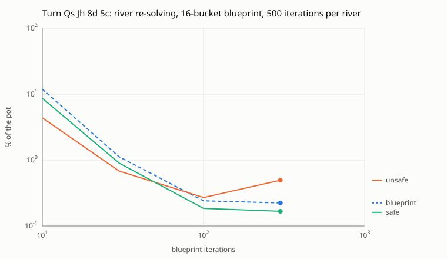

DCFR everywhere, 500 iterations per river (twice per river for the gadgets,
once per player), exploitability as a share of the pot. Exact blueprint:

| blueprint iterations | blueprint | unsafe | resolve | maxmargin | reach-resolve | reach-maxmargin |
|---------------------:|----------:|-------:|--------:|----------:|--------------:|----------------:|
| 10                   | 10.3      | 3.03   | 6.67    | 4.48      | 6.67          | 4.48            |
| 30                   | 0.848     | 0.392  | 0.654   | 0.569     | 0.649         | 0.563           |
| 100                  | 0.0898    | 0.0844 | 0.0689  | 0.0596    | 0.0687        | 0.0587          |
| 300                  | 0.0140    | 0.0311 | 0.0124  | 0.0105    | 0.0117        | 0.0101          |

Blueprint with 16 hand-strength buckets on every river:

| blueprint iterations | blueprint | unsafe | resolve | maxmargin | reach-resolve | reach-maxmargin |
|---------------------:|----------:|-------:|--------:|----------:|--------------:|----------------:|
| 10                   | 11.9      | 4.37   | 8.67    | 6.79      | 8.66          | 6.79            |
| 30                   | 1.12      | 0.681  | 0.889   | 0.795     | 0.887         | 0.790           |
| 100                  | 0.241     | 0.270  | 0.183   | 0.165     | 0.182         | 0.162           |
| 300                  | 0.224     | 0.495  | 0.167   | 0.152     | 0.167         | 0.152           |

Every gadget improved every blueprint, and max-margin beat resolve every
time, by 9 to 33%. Reach gifts matter much less: at 300 exact iterations they
take 6% off resolve and 3% off max-margin, everywhere else under 2%, and at
10 exact iterations reach-resolve comes out 0.04% worse than resolve. The gifts are small because
each river is one of 44 below a chance node and gets 1/44 of the gift, which
is what Brown and Sandholm saw too: their "not split" variant, which gives
every subgame the whole gift and drops the guarantee, did much better than
the safe split. Unsafe re-solving does better on bad blueprints, since it
throws the blueprint's river away and keeps only the ranges, but once the
blueprint is good it makes things worse: 2.2x on both 300-iteration
blueprints. With 16 river buckets the blueprint has stalled by 100
iterations (0.24% and then 0.22% of the pot), and reach-maxmargin takes 32%
off that. All of this needs the gadget game to be solved; 500 iterations per
river is enough here. Each gadget method takes 80 to 110 s for its 864 river
solves on one core, unsafe about 55 s. The exact-blueprint chart is
`docs/resolve.svg`.

## Building

Needs OCaml 5.1 or newer and opam.

```
opam install . --deps-only --with-test
dune build
dune test
dune exec cfr-solver -- solve --help
```

## How it works

**Games.** A game is a module with a history type and one function,
`node : history -> history node`:

```ocaml
type 'h node =
  | Terminal of float                  (* payoff to player 0 *)
  | Chance of (float * 'h) list
  | Decision of { player : player; infoset : string; actions : (string * 'h) list }
```

Solvers are functors over this signature, so `Cfr.Make (Kuhn)` and
`Best_response.Make (Kuhn)` work for any game that follows the contract (keys
unique per player, same actions at every history of an infoset, perfect
recall). The test suite checks that contract by walking the whole tree.

**Compiled tree** (`lib/tree.ml`). `node` is lazy, so walking it rebuilds
lists and infoset-key strings on every visit. The solver builds the tree once
instead, numbers the infosets, and keeps regrets, strategy sums and the cached
strategy in flat float arrays where infoset i owns a contiguous slice. On Leduc
that took 10,000 iterations of vanilla CFR from 3.63 s to 0.17 s with the same
output to the last printed digit. The walks don't allocate either: reach
probabilities live in a per-depth float array and each call writes its value
into a one-slot float array, because OCaml boxes a float passed to or returned
from a recursive function. `dune exec ./bench/bench.exe` measures it on a
Ryzen 7 7800X3D: full-tree CFR walks about 100 million nodes a second (1.8
million vanilla iterations a second on Kuhn, 57,000 on Leduc), external
sampling about 78 million and outcome sampling about 51 million, with 0 words
allocated per sampled iteration.

**CFR** (`lib/cfr.ml`). Each iteration walks the tree once, carrying both
players' reach probabilities and chance's. At a decision it adds
`opponent reach x chance reach x (v(a) - v)` to each action's regret and the
player's own reach times the current strategy to the strategy sum. The next
strategy comes from regret matching, and the average strategy is what
converges. One detail matters: an infoset is visited once per history inside
it, so the current strategy is computed once per iteration and cached.
Recomputing it on every visit still converges at about the same speed, but it
is a different algorithm, and the exact check against OpenSpiel's two-iteration
values catches it.

**Variants.** CFR+, linear CFR and discounted CFR all fit one rule from Brown
and Sandholm's DCFR paper: at the end of iteration t, multiply positive
regrets by t^alpha / (t^alpha + 1), negative regrets by t^beta / (t^beta + 1),
and give iteration t weight t^gamma in the average strategy. Vanilla CFR is
(inf, inf, 0), CFR+ is (inf, -inf, 1), so negative regrets reset to zero every
iteration, linear CFR is (1, 1, 1) and the recommended DCFR is (1.5, 0, 2). The
solver implements that rule once, and the variants are just parameters plus
one switch: all except vanilla update the players alternately, player 1 on
each iteration playing against player 0's freshly updated strategy. That
switch matters. CFR+ with simultaneous updates fails OpenSpiel's CFR+
convergence test.

DCFR+ is (1.5, -inf, 4) in the same rule. The predictive variants add one
switch more: match on the stored regrets plus the last pass's instantaneous
regrets instead of the stored regrets alone.

**Dilated FTRL** (`lib/dilated.ml`). Works on the sequence form instead of
regrets. Each iteration walks the tree once with both players' current
strategies, adds every leaf's payoff times chance and opponent reach to the
last sequence of each player, and then recomputes both strategies from the
cumulative payoffs in one bottom-up pass over the infosets
(`Dilated.response`).

**Monte Carlo CFR** (`lib/mccfr.ml`). Instead of walking the whole tree,
each iteration samples part of it and updates regrets with estimates whose
expectation is exactly the full-tree update. External sampling (Lanctot et al.,
2009) takes one traversal per player: chance and the opponent each sample one
action from their current strategy, while every action of the traversing
player is explored. The sampling probabilities cancel against the reach
weights, so the regret update is just `v(a) - v` on the sampled values. The
opponent's strategy sum gets their current strategy added at every visit,
which in expectation is their own reach times chance reach; the chance factor
is the same on every iteration for a given infoset, so it drops out when the
sum is normalized. Outcome sampling follows a single path: the traversing
player samples from a mix of 60% uniform and 40% current strategy (OpenSpiel's
default), the terminal payoff is divided by the probability of having sampled
that path, and the regret of the sampled action gets `w (1 - sigma(a))` while
the others get `-w sigma(a)`. Both share the regret tables and the per-pass
strategy cache with full-tree CFR (`lib/table.ml`). Each solver owns a
SplitMix64 generator, and `split` hands out a copy seeded from the parent's
next output.

**Best response** (`lib/best_response.ml`). The responder has to pick one
action per infoset without seeing the opponent's card. So the solver first
gathers every history in each of the responder's infosets with its weight
(chance times opponent reach), then picks the action with the highest weighted
sum, deciding deeper infosets first through memoized recursion. Exploitability
is half the sum of the two best-response values (the convention OpenSpiel
uses), and it is zero exactly at an equilibrium.

## Testing

The tests check against numbers that come from outside this code:

- OpenSpiel's published values: NashConv of the uniform policy is 11/12, of
  always-pass is 2, and of every member of the equilibrium family is 0. The
  best-response actions against uniform match theirs, including an exact tie
  (a king is worth 1.5 either way). After two CFR iterations the average
  strategy at `Qb` is exactly [1/4, 3/4].
- A property test (qcheck, 300 random profiles): the best response equals the
  maximum over all 64 pure strategies, enumerated by brute force, and playing
  it earns exactly that value.
- Payoffs and game values derived by hand, including -1/18 for the
  equilibrium family at several values of alpha.
- Regret matching on rock-paper-scissors converges to uniform in self-play.
- Leduc: OpenSpiel's NashConv of 4.747222 for the uniform policy and 2 for
  always taking the first action, hand-counted tree sizes, and payoffs worked
  out by hand (raise-fold, re-raise-fold, a pair beating a king, a split pot,
  the 13-chip maximum pot).
- Liar's dice: OpenSpiel's 24,576 infosets, tree sizes counted in closed form
  for four variants (1 + m^2 (2^(B+1) - 1) histories with m rolls per player
  and B possible bids), roll
  probabilities, bid truth with and without wilds, and game values from an
  independent sequence-form LP, including -7/258 for the standard game.
- Auctions: payoffs and best-response gains against an explicit game tree
  built separately (24 rule, tie and reserve combinations, random profiles),
  the fast solver matching the full-tree n-player CFR iterate for iterate,
  Rasooly and Gavidia-Calderon's Propositions 2 and 3 by exhaustive search in
  rationals, truthful bidding as an exact second-price equilibrium, E[min of
  two values] as exact revenue, 1/3 and Myerson's 5/12 from the continuous
  formula, which is itself checked against a Simpson integral, and the
  3 sqrt(2) - 4 mix to 1e-9.
- Market game: terminal and infoset counts in closed form, payoffs and infoset
  keys along hand-picked paths, the revealing maker's 2/3 loss derived by
  hand, a wide enough market worth exactly 0, and the exact LP value inside
  the DCFR best-response bracket with an exact gap of 0.
- Three or more players: the n-player solver run on two-player Kuhn and
  Leduc (built both natively and through `Multi.Of_game`) reproduces the
  two-player solver's strategies to 1e-11 under all four variants; three-player
  Kuhn's sizes (600 histories, 48 infosets) and three-player Leduc's (396,120
  and 13,878 with suits told apart) match Lu, Zhu and Zhao's table; payoffs
  are worked out by hand, including a split pot and a folded player skipped
  in the second round; the best response equals a brute-force search over all
  16 pure strategies per card (qcheck, 40 random profiles); and DCFR lands in
  the Szafron et al. equilibrium family (second player at -1/48, beta in
  [0, 1], no opening bets) in 2,000 iterations.
- External sampling for n players: on two-player Kuhn and Leduc it matches
  `Mccfr` exactly (nodes touched and every probability) under three
  weightings and both sampled averaging rules; with frozen regrets and two
  alternating profiles on three-player Kuhn, `Weighted` averaging comes within
  0.025 of the exact own-reach mix after 40,000 rounds, `Full` within 1e-12,
  and `Simple` stays more than 0.03 away; a pass only moves the traverser's
  strategy; runs are reproducible by seed; and every averaging rule lands near
  the Szafron family (second player within 0.01 of -1/48).
- The array best response against the old one (kept in
  `test/multi_br_ref.ml`) on random profiles with zeros in them, on three- and
  four-player Kuhn, Leduc and six-card three-player Leduc: values and gains to
  1e-12, and the strategy it returns earns what it claims.
- `Multi_profile`: the distance is zero to itself, symmetric and inside
  (0, 1) for different profiles; mixing two profiles that differ for one
  player gives exactly the mean of their values; mixing a profile with itself
  gives it back.
- Every CFR variant against a slow reference implementation in
  `test/reference_cfr.ml`, written separately: it enumerates histories with
  their reach probabilities instead of carrying them in one walk, evaluates
  every child with its own expected-value pass, and restates the DCFR weights
  from the paper. After 30 iterations on Kuhn the average strategies agree to
  1e-10, for the four named variants and for 20 random (alpha, beta, gamma).
- CFR+ meets OpenSpiel's own CFR+ test (value within 1e-3 and exploitability
  under 1e-3 after 200 Kuhn iterations), and gets Leduc's value to 1e-4 in 500.

- Monte Carlo CFR against exact expectations: from a solver state after a few
  iterations, the test splits off thousands of copies, runs one sampled
  traversal on each, and compares the mean change of every regret and
  strategy-sum entry with the exact expected change computed by a separate
  full-tree walk, within five standard errors. That runs for both samplers,
  both players, on Kuhn and on Leduc. For entries that are rarely sampled the
  standard error gets a floor from Var X <= max|X| E|X|.
- An exact identity: weighted by the current strategy, one traversal's regret
  changes sum to zero at every infoset (qcheck, 200 random states per sampler).
- External sampling gets Kuhn under 0.01 exploitability in 20,000 iterations
  (mean of five seeds) and Leduc under 0.06 in 100,000, with the game values
  close to -1/18 and -0.0856.
- The random generator reproduces the published SplitMix64 outputs for seed
  1234567, which a separate Python implementation also gives.
- Discounting is weighting: after T iterations discounted with linear factors,
  regrets and strategy sums equal sum t x_t / (T + 1) of the raw increments,
  and DCFR's strategy sums equal sum t^2 x_t / (T + 1)^2 (qcheck, 200 random
  sequences).
- Parallel MCCFR on one domain is bit for bit the serial solver in both modes,
  with and without weighting. Three private rounds on three domains match a
  merge written out by hand. Private runs are deterministic, iteration and
  round counts are exact when the batch doesn't divide the work, and both modes
  converge on 4 domains. A barrier test runs 4 domains through 500 phases and
  checks that none gets ahead.
- The domain pool runs every index exactly once over changing domain counts,
  keeps each index on the same domain across 50 calls, survives 2,000 rounds,
  passes exceptions from workers and the caller back to the caller, and joins
  its domains on shutdown.
- Abstraction: the exact abstraction maps every infoset to itself; solving a
  renamed copy of Leduc with CFR+ and lifting it back gives the full-game
  result exactly; for 40 random abstractions (perfect and imperfect recall)
  and random abstract strategies, the abstract game's value equals the full
  game's value of the lifted strategy to 1e-12; an abstraction that refines
  instead of coarsening is rejected.
- Leduc decks: tree sizes for 13 ranks match the closed forms (6n + 30n^2
  infosets), the contract walk passes for 13x2 and 4x3 decks, and both players
  pairing the board splits the pot.
- Hand strength: values worked out by hand for standard Leduc (E[HS] of 0.3,
  0.5 and 0.7), a mean of exactly 1/2 for 100 random decks, and 2 E[HS] - 1
  equal to the game's own expected payoff when both players check to the
  showdown.
- Clustering: optimal 1D k-means matches brute force over every labeling
  (qcheck, 300 cases); EMD between equal-size samples on a grid equals the
  mean distance between their sorted values; the weighted median minimizes
  weighted L1; k-medians recovers three separated blobs and ends at a fixed
  point where every histogram's nearest center is its own. EMD between sorted
  samples equals the best of all assignments (brute force over permutations)
  and equals the binned EMD on grid samples; quantile k-medians recovers
  three shifted groups, orders buckets by mean and ends at a fixed point.
- Turn features: each hand's river distribution against brute-force hand
  strength on every river, equal distributions always getting equal E[HS^2]
  and equal buckets under every feature, exact EMD with k at least the number
  of distributions giving one bucket per distribution, EMD buckets having a
  lower EMD clustering cost than E[HS^2] buckets, and river buckets staying
  on hand strength whatever the turn feature. Bucketed solves with EMD and
  potential-aware turn buckets match `Cfr.Make` on the bucketed game.
- Re-solving: river roots carry the reach mass `Subgame.lines` reports and
  the pot of their line, restricting a profile to a river and grafting it
  back is the identity, per-hand CBVs sum to the best response, a gadget with
  very low alternatives reproduces the plain solve bit for bit, after 2,000
  iterations of the gadget no opponent hand's best-response value is above
  its alternative (checked on 8 river solves, the worst gap is exactly 0),
  and all four gadgets lower the exploitability of 1-, 10- and
  100-iteration blueprints. After every river is re-solved with any of the
  four, no opponent hand's best-response value at the turn root is higher
  than against the blueprint, including when the blueprint folds its best
  hands so they never reach a river. Max-margin's smallest margin is never
  below resolve's. Gifts are checked against a separate computation: the
  call line's fold value and river-by-river best-response values summed with
  the 1/44 chance weight, and the raised alternatives on the 48 rivers below
  sum back to exactly the gift.
- The hand evaluator: all five-card hands, the best-of-21 property, and hands
  that trip up evaluators (wheels, a third pair as kicker, two sets of trips,
  a flush and a straight in the same seven cards).
- Subgames against the scalar solver: `test/subgame_ref.ml` writes the same
  river or turn as an ordinary `Game.S`, with chance dealing every compatible
  pair of hands (weighted by the ranges) and then the river card, so
  `Cfr.Make`, `Best_response.Make` and `Eval.Make` run on it unchanged. On a
  river with overlapping ranges, ties and uneven weights, 25 iterations of
  vanilla CFR, CFR+ and DCFR give the same average strategy as the vector
  solver to 1e-9 at every infoset, and the game value and both best responses
  agree to 1e-9. On a turn they agree for 3 iterations. After that the two
  solvers break an exact tie differently: at one infoset all regrets are zero
  in exact arithmetic, the scalar solver plays uniform and the vector solver,
  with a rounding-size positive regret, a pure fold (most likely
  inclusion-exclusion rounding where every opponent hand reaching the node
  shares a card with mine). Both are valid CFR+ iterates, and the values and
  best responses still agree to 1e-9.
- Suit isomorphism: the 24 suit permutations, the symmetry group and number of
  river classes for rainbow, two-tone, paired and monotone boards, and which
  ranges keep the symmetry. Folded and unfolded solves agree to 1e-9 at every
  real infoset on a monotone turn (CFR, CFR+, DCFR) and on a monotone flop
  with two nested chance levels, and the folded strategy is bit for bit equal
  across symmetric hands.
- Hand strength against brute-force enumeration on three rivers, a mean of
  exactly 1/2 over all 1,081 hands, 1 for the nuts and 1/2 for everyone when
  the board plays, and E[HS^2] against the mean of brute-force HS^2 over the
  river cards.
- Bucketed subgames against `Cfr.Make` on the same abstracted game (above),
  float32 runs against double runs, and pruned runs bit for bit equal to
  unpruned ones.
- Regret-based pruning: on a one-bet river where every pruned action leads
  only to opponent decisions, the best response in the catch-up has nothing to
  choose, so RBP has to reproduce plain CFR. After 400 iterations of CFR and of
  linear CFR, with 294 subtrees pruned and 60 windows caught up, the average
  strategies and best responses match to 1e-9 and every cumulative regret to
  1e-6. On a no-limit river with raises (where the best response does choose)
  exploitability after 2,000 iterations is within a third of the plain run's,
  folded and unfolded monotone turns agree to 1e-9 with pruning on, and
  reading the averages in the middle of a run (which flushes the deferred
  strategy sums) leaves the regrets bit for bit unchanged.
- The clairvoyance game from The Mathematics of Poker, on real cards: player 0
  holds the nuts or air with equal weight, player 1 a bluff catcher, and the
  only bet is the pot. Theory says bluff with air half the time, call half the
  time, and player 0 makes 1 chip a hand in a pot of 4 that both players put 2
  into. CFR+ gets the value within 1e-3 and both frequencies within 0.02.
- Bet trees: the fixed-limit river has 10 decisions and 17 terminals with
  payoffs worked out by hand, the turn 100 decisions, pot-fraction raises,
  clamps to all-in and caps land on the amounts computed by hand.
- Ranges: combo counts for every notation (6 per pair, 4 suited, 12 offsuit,
  1,081 random hands on a river), board removal and weights.
- Translation: the pseudo-harmonic identity above, the endpoints and
  monotonicity of all three mappings, translating a tree into itself gives
  the same strategy, adding a size that the translated player never uses
  keeps the game value to 1e-9 and can only raise the best responses, the
  value is linear in the mapping probability, and with a short stack where
  re-raises clamp to all-in every translated node still sums to 1.

Hand-made bugs get caught: a best response that decides from a single history,
a CFR without the strategy cache, an average weighted by t + 1 instead of t, a
discount applied with the previous iteration's t, and CFR+ with simultaneous
updates each fail at least two tests. So do five MCCFR bugs: dropping the
(1 - sigma) factor in outcome sampling, dropping its importance weight in the
strategy sum, weighting by the current strategy instead of the sampling
policy, sampling the opponent uniformly in external sampling, and adding the
square root of the opponent's strategy to its strategy sum. So do six
parallel ones: merging without subtracting the master, an off-by-one in how
iterations are split between domains, giving shared mode a private master,
skipping the copy back after a merge, dropping the per-round discount, and
folding the shared strategy sums without resetting them. The newer code gets
the same treatment: a pool that lets every worker run, a lift that drops part
of the abstract strategy, ties counted as wins in hand strength, round 2
buckets indexed with card and board swapped, k-medians assigning to the
farthest center, an off-by-one in the k-means split points and a weighted
median taken at a third of the weight. For the subgames: dropping the
identical-combo term from folds, counting ties as wins in the showdown sweep,
and the wrong probability for the river card fail 4, 5 and 3 tests, and
translating by a plain average of strategies instead of the reach-weighted
mixture fails the linearity test. Folding with the permutation
instead of its inverse, skipping the images in the best response, composing
nested suit permutations in the wrong order (only the flop test catches that
one), not tying symmetric regrets, unweighted bucket regrets, a float32 path
without the regret floor, and a pruned walk that forgets the strategy sums
each fail at least one test. For regret-based pruning, a catch-up that skips
the pruned action's own regret, no bound at all, a bound that is too tight,
linear CFR without the scale, deferred strategy sums that are dropped or never
flushed, and a mean instead of a best response in the catch-up each fail at
least two tests. Two mutants survive: a bound that leaves out tied hands (too
tight, but it never changed a decision in the tests) and leaving out one
symmetrization after a catch-up, which only matters at rounding level.

For re-solving, a gadget that always plays and alternatives taken from the
blueprint's mean values instead of best-response values each fail at least
one test. The second one still passes the end-to-end safety test, which is
why the per-hand bound test exists. Gifts given whole to every river (times
44) fail the test that sums each river's raised alternatives back up to the
gift on the turn, and a gadget that only covers hands the blueprint brings to
the river fails the test that makes the blueprint fold its sets: their
counterfactual value at the turn root goes up by 26%. Plain regret matching
instead of RM+ in the max-margin chooser fails three tests on convergence.
Gifts from every action instead of only folds survive, and should: they are
still safe, only no longer a lower bound once the other rivers are re-solved.

The predictive variants are checked against a second implementation in the
tests that follows the papers' formulas literally (undiscounted R, the
prediction computed from it each time) on Kuhn, for the named settings and 20
random (alpha, gamma), to 1e-10, and the subgame solver against `Cfr.Make` on
river, turn, bucketed and suit-folded trees to 1e-9. Skipping the swap that
makes the last pass's regrets the prediction, matching without the
prediction, writing R instead of R + r back into the subgame store, and
reading r back without subtracting the old one each fail at least four
tests. For dilated FTRL, leaving the child infosets' values out of the
softmax fails five of its six tests and turning optimism off fails two.

## License

MIT
