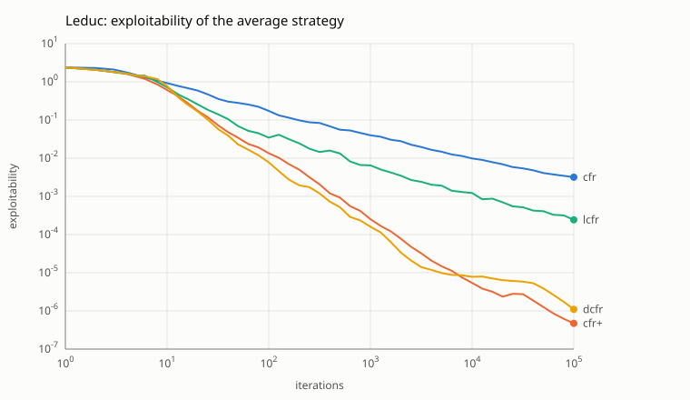
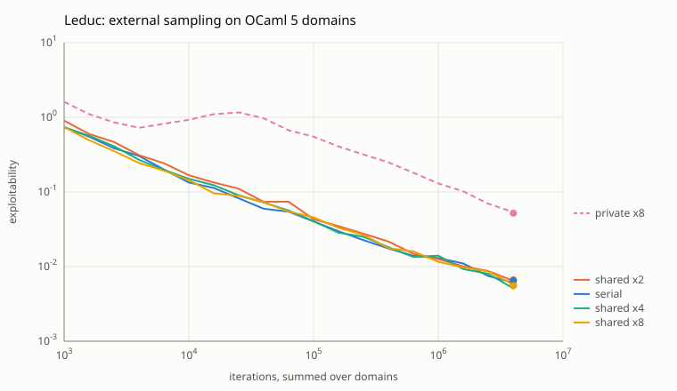
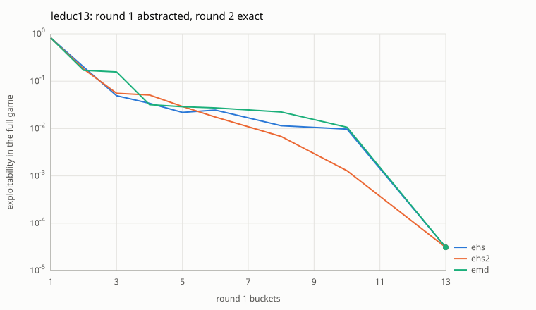
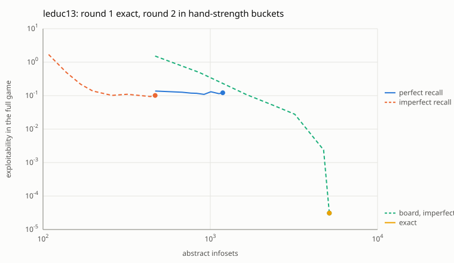
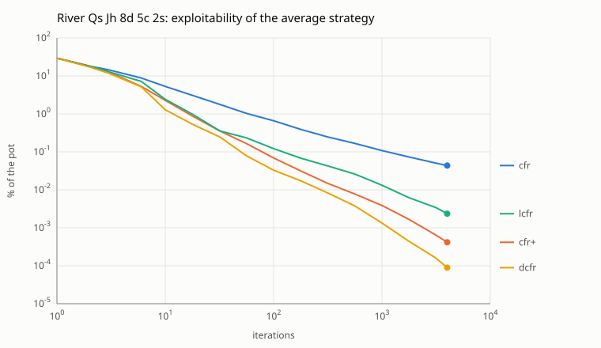
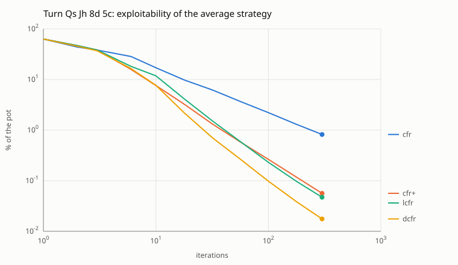
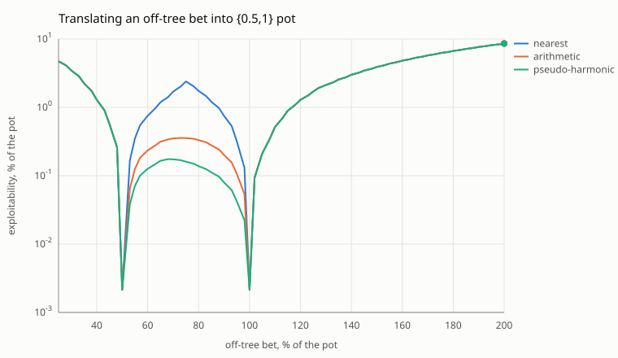

# cfr-solver

Nash-equilibrium strategies for imperfect-information games, computed in OCaml
with counterfactual regret minimization (CFR). It solves Kuhn poker and Leduc
hold'em with four full-tree CFR variants (vanilla CFR, CFR+, linear CFR and
discounted CFR) and two Monte Carlo ones (external and outcome sampling), runs
the Monte Carlo ones in parallel on OCaml 5 domains, and measures how far any
strategy is from equilibrium with an exact best response. It also builds card
abstractions (hand-strength buckets, optimal 1D k-means, k-medians under earth
mover's distance) and measures exactly what each one costs. For hold'em it
solves river and turn subgames over full ranges with a vectorized CFR on the
public tree, under fixed-limit or no-limit betting, and maps bet sizes that
are missing from the tree onto the ones that are there (action translation).



## Example

```
$ dune exec cfr-solver -- solve -n 10000
kuhn: 10000 iterations of cfr in 0.00 s
nodes touched   550000
game value      -0.055546 (player 0)
exploitability  2.318e-03

player 0
  J    p 0.792  b 0.208
  Jpb  p 1.000  b 0.000
  Q    p 1.000  b 0.000
  Qpb  p 0.449  b 0.551
  K    p 0.387  b 0.613
  Kpb  p 0.000  b 1.000

player 1
  Qp  p 1.000  b 0.000
  Qb  p 0.661  b 0.339
  Kp  p 0.000  b 1.000
  Kb  p 0.000  b 1.000
  Jp  p 0.665  b 0.335
  Jb  p 1.000  b 0.000
```

Each row is an information set: the player's card, then the moves so far
(`p` is check or fold, `b` is bet or call). So `Qpb` is player 0 holding the
queen after checking and facing a bet.

The output matches the theory. Kuhn poker has a one-parameter family of
equilibria: player 0 bluffs a jack with some probability alpha in [0, 1/3],
bets a king with 3 alpha and calls with a queen with alpha + 1/3. Here CFR
landed on alpha = 0.208, with the king bet at 0.613 (3 alpha = 0.623) and the
queen call at 0.551 (alpha + 1/3 = 0.541). Player 1's equilibrium is unique
(bluff a jack and call with a queen 1/3 of the time), and CFR gets 0.335 and
0.339. The game is worth -1/18 = -0.0556 to player 0.

`--json FILE` writes the strategy as JSON, `--trace FILE` writes
exploitability at 1, 2, 5, 10, 20, ... iterations as CSV, and `-a` picks the
algorithm (`cfr`, `cfr+`, `lcfr`, `dcfr`, `es`, `os`). The sampled ones take
`--seed`, `--domains D` to run on D domains (`--private` for the deterministic
mode below) and `-w lcfr|dcfr|cfr+` to discount them like the full-tree
variants.

## Leduc hold'em

Leduc is the standard next step after Kuhn: six cards (two each of J, Q, K),
two betting rounds with raises of 2 and 4, a public board card, and pairs
beating high cards. The rules follow OpenSpiel's `leduc_poker`. Suits never
matter, so the solver deals ranks and works with 288 infosets where OpenSpiel
has 936; the uniform policy's NashConv comes out at 4.747222, the value
OpenSpiel's tests use.

```
$ dune exec cfr-solver -- solve -g leduc -a dcfr -n 10000
leduc: 10000 iterations of dcfr(1.5,0,2) in 0.34 s
nodes touched   38780000
game value      -0.085606 (player 0)
exploitability  7.805e-06
```

Player 0 loses 0.0856 chips a hand at equilibrium, the value usually quoted for
Leduc. A few of the first-round decisions from that run (`c` is check or call,
`r` raise, `f` fold):

| infoset | meaning                              | f     | c     | r     |
|---------|--------------------------------------|------:|------:|------:|
| `J:`    | player 0 opens with a jack           |       | 0.928 | 0.072 |
| `K:`    | player 0 opens with a king           |       | 0.248 | 0.752 |
| `J:cr`  | player 0 checked a jack, faces a raise | 0.946 | 0.036 | 0.018 |
| `J:r`   | player 1 holds a jack, faces a raise | 0.819 | 0.126 | 0.055 |
| `K:c`   | player 1 holds a king after a check  |       | 0.000 | 1.000 |

Leduc's equilibrium is not unique, so another algorithm can land on different
mixes with the same value and exploitability.

## Convergence

`cfr-solver compare -g GAME -n N --svg FILE` runs all six algorithms on the
same budget of work and plots exploitability of the average strategy. Work is
counted in nodes touched, because an iteration means very different things: a
full-tree pass over Leduc visits 1,939 nodes, an external-sampling iteration
about 45 and an outcome-sampling one about 16. The budget is what N iterations
of an alternating full-tree variant cost (vanilla CFR updates both players in
one pass, so it gets 2N iterations). The chart at the top is Leduc with
N = 100,000, about 388 million nodes; dashed lines are the sampled methods.

| Leduc, nodes | cfr      | cfr+     | lcfr     | dcfr     | es       | os       |
|-------------:|---------:|---------:|---------:|---------:|---------:|---------:|
| 1,000        | -        | -        | -        | -        | 2.92     | 2.59     |
| 100,000      | 3.05e-1  | 1.60e-1  | 2.28e-1  | 1.57e-1  | 5.16e-1  | 1.43     |
| 10^7         | 1.73e-2  | 7.50e-5  | 3.97e-3  | 3.35e-5  | 2.83e-2  | 1.13e-1  |
| 3.88 x 10^8  | 2.03e-3  | 4.73e-7  | 2.43e-4  | 1.10e-6  | 5.26e-3  | 1.09e-2  |
| cpu seconds  | 3.47     | 3.77     | 3.64     | 3.64     | 4.94     | 7.50     |

Per node touched, neither sampler beats vanilla CFR on Leduc: external sampling
ends about 2.6 times more exploitable and outcome sampling about 5 times. They
do something else well. Each iteration is cheap, so they start learning before a
single full pass has finished, and their cost per iteration doesn't grow with
the tree, which is what matters once a game is too big to walk. CFR+ and DCFR
are in another league on a game this small: after the same work CFR+ is about
4,000 times less exploitable than vanilla CFR. Linear CFR, which keeps negative
regrets and only reweights them, stalls on Leduc; Brown and Sandholm saw the
same kind of game dependence (it was poor on Goofspiel). The Kuhn chart is in
[docs/kuhn.svg](docs/kuhn.svg), and the raw curves are in `docs/*.csv`.

## Parallel Monte Carlo CFR

External sampling looks embarrassingly parallel: given the regrets, every
traversal is independent. The catch is that the regrets are what every
traversal reads. `Parallel.Make (G)` runs MCCFR on several OCaml 5 domains in
one of two modes.

**Shared tables** (the default). Every domain reads and writes one regret
table with no locks, the way multithreaded blueprint solvers do it. Two domains
can update the same regret at the same moment and one increment gets lost. In
OCaml 5 that is a data race with defined behaviour (no torn floats, no memory
unsafety), and on Leduc it costs nothing measurable. Strategy sums never feed
back into play, so they are not shared: each domain accumulates its own and
they are added up when the run ends, the way per-CPU counters work. That halved
the writes to shared cache lines and took 8 domains from 0.67 s to 0.54 s on a
4-million-iteration run. With more than one domain the result is not
reproducible.

**Private tables** (`--private`). Each domain runs `--batch` iterations on its
own copy of the tables, then the domains meet at a barrier and merge,
`master += sum_j (table_j - master)`, each domain merging its own stripe of
slots, and everyone copies the master back. The result is deterministic for a
given seed, domain count, batch and sequence of `run` calls, and nothing races.
The price is staleness: a domain plays a strategy that has not seen the other
domains' last batch, and regret matching on stale regrets converges more slowly
(the regret bound grows with the square root of the delay).

```
$ cfr-solver scale -g leduc -n 4000000 --svg docs/scale.svg
```



The chart counts iterations summed over domains, so a mode that loses nothing
to parallelism sits on the serial line. The shared runs do. Private tables on 8
domains with batches of 1,000 end 8 times more exploitable after the same 4
million iterations.

Wall time for those 4 million iterations, one uninterrupted run each, on a
Ryzen 7 7800X3D (8 cores, 16 threads) under Windows. The first pair of columns
pins the process to one logical CPU per core (`start /affinity 5555`), the
second lets Windows schedule it.

| config      | pinned (s) | speedup | default (s) | speedup | exploitability |
|-------------|-----------:|--------:|------------:|--------:|---------------:|
| serial      | 2.25       | 1.00    | 2.25        | 1.00    | 6.44e-3        |
| shared x2   | 1.30       | 1.73    | 1.37        | 1.64    | 6.14e-3        |
| shared x4   | 0.75       | 2.99    | 1.00        | 2.25    | 7.02e-3        |
| shared x8   | 0.47       | 4.75    | 0.61        | 3.68    | 8.09e-3        |
| private x8  | 0.33       | 6.83    | 0.56        | 4.00    | 5.45e-2        |

Shared tables flatten out past 4 domains because Leduc's whole regret table is
672 floats (5.4 KB) and every domain writes all of it, so the cores spend their time
passing cache lines back and forth. Private tables scale almost linearly and
give it all back in staleness. On a game this small, shared tables win at any
fixed wall time. Unpinned, Windows often puts two domains on the two threads of
one core: fully independent solvers with no shared data at all hit the same
ceiling (1.6x on 2 domains), so that part is the scheduler, not the solver.

Two fixes came before any of this scaled. `Random.State` keeps its state in a
32-byte bigarray allocated with `malloc`, so two domains' generators can land
on one cache line, and two domains drawing random numbers ran 3 times slower
than one. The solver now uses its own SplitMix64 (`lib/rng.ml`) with the state
in a 64-byte `Bytes` that each domain allocates for itself. And one tuple
allocated per iteration was enough to stall every domain, because OCaml 5
minor collections stop the world. The walks and the iteration loop allocate
nothing now.

The domains are spawned once. `lib/pool.ml` keeps worker domains parked on a
condition variable between calls; `Parallel.run` hands every worker the same
job, runs its own share on the calling domain and waits for the rest. Worker j
is always the same domain, so the tables it allocated on its first run stay
where they are. Before the pool, every `run` call spawned and joined its
domains. Splitting 4 million iterations into 400 calls on 8 domains
(`dune exec ./bench/bench.exe`) cost 15.9 ms a call before and 1.9 ms after,
and about 1.6 ms of that is the work itself.

## Weighted Monte Carlo CFR

`-w lcfr`, `-w dcfr` and `-w cfr+` apply the full-tree discounts to the sampled
solvers once every `--batch` iterations (discounting per interval of
iterations is how Pluribus did it). On Leduc it mostly hurts. Mean
exploitability of external sampling over 8 seeds, discounting every iteration:

| iterations | none   | lcfr   | dcfr   | cfr+   |
|-----------:|-------:|-------:|-------:|-------:|
| 1,000      | 0.759  | 0.597  | 0.677  | 0.717  |
| 10,000     | 0.158  | 0.140  | 0.195  | 0.193  |
| 100,000    | 0.0467 | 0.0481 | 0.0634 | 0.0626 |
| 1,000,000  | 0.0129 | 0.0150 | 0.0207 | 0.0207 |

Linear weighting helps early and the advantage is gone by 100,000 iterations.
DCFR and CFR+ end 60% worse. Both cut negative regrets (DCFR halves them, CFR+
zeroes them), and with sampled regrets that is not neutral: a noisy negative
estimate gets cut while a noisy positive one is kept, so the regrets drift
upward. Discounting only the first 10,000 or 100,000 iterations, as Pluribus
did early in training, came out the same as no discounting at 1 million.
Outcome sampling shows the same pattern.

## Card abstraction

Real poker has too many hands to give each its own strategy, so solvers group
hands into buckets and solve the smaller game. How much that costs is usually
hard to know, because the real game is too big to evaluate. Here it isn't.
`Leduc.game` takes any deck, and with 13 ranks and two suits (`leduc13`, 26
cards, 166,349 histories, 5,148 infosets) the hands differ enough for buckets
to matter while an exact best response takes 0.2 s. An
abstraction is a function from a player's private card (and the board) to a
label. `Leduc.game ~abstraction` builds the abstract game over the same
histories, CFR+ solves it, `Abstraction.Make (Full) (Abs)` maps every real
infoset to its abstract one and lifts the strategy back, and the exploitability
is measured in the full game.

The features come from hand strength: HS(c, b) is the chance that card c beats
a random opponent card on board b, ties counting half. Before the board is
dealt the strength is a distribution, which the solver summarizes three ways:
its mean E[HS], its second moment E[HS^2] (which rewards hands whose strength
can still swing up), or the whole distribution as a 20-bin histogram. Scalar
features are bucketed by exact 1D k-means: on sorted values the clusters are
contiguous runs, so a dynamic program over split points finds the optimal
partition in O(k n^2). Histograms are clustered by k-medians under earth
mover's distance with k-means++ seeding. In one dimension EMD is the L1
distance between the two CDFs, so the best center of a cluster is the
pointwise weighted median of its members' CDFs (itself a valid CDF), and every
Lloyd step can only lower the cost.

```
$ cfr-solver abstract -n 4000 --csv docs/abstraction.csv --svg docs/abstraction.svg
leduc13: 4000 iterations of cfr+ per abstraction, 44 jobs in 112.5 s
```

The 44 abstract games run side by side on the domain pool. The exact game
after the same 4,000 iterations is at 3.1e-5, so everything above that is the
abstraction.



| round 1 buckets | 1     | 2     | 3      | 4      | 5      | 6      | 8       | 10      |
|-----------------|------:|------:|-------:|-------:|-------:|-------:|--------:|--------:|
| E[HS]           | 0.821 | 0.198 | 0.0493 | 0.0341 | 0.0219 | 0.0246 | 0.0115  | 0.0097  |
| E[HS^2]         | 0.821 | 0.180 | 0.0555 | 0.0511 | 0.0292 | 0.0175 | 0.0068  | 0.0013  |
| EMD histogram   | 0.821 | 0.170 | 0.157  | 0.0320 | 0.0290 | 0.0272 | 0.0223  | 0.0106  |

Here round 2 keeps the exact card and board. Playing the first round blind
costs 0.82 chips a hand; three E[HS] buckets bring it down to 0.049. No feature wins
everywhere. The histograms are best at 2 and 4 buckets, E[HS^2] from 6 on, and
at 10 buckets it is 7 to 8 times better than the other two. More buckets is not always
better either: E[HS] gets worse from 5 to 6. The two partitions aren't nested,
so this isn't quite the refinement pathology of Waugh et al. (2009), but it is
the same warning. The histograms have less to work with than in hold'em: every
card has the same spike of mass 1/25 at HS = 1 (pairing the board), and
otherwise only two strengths, board above or below the card.



The second chart keeps round 1 exact and buckets round 2 by HS. With perfect
recall the key is the card plus the bucket; with imperfect recall the player
forgets the card and keeps only the bucket (and the betting). Hand strength
alone stalls at about 0.1 however many buckets it gets, because on leduc13 it
takes only 13 values: card c with the board above it has HS (2c + 0.5)/24,
exactly the same as card c + 1 with the board below it. Those are different
spots (in the second the opponent can pair the board), and no bucketing of HS
can tell them apart. Forgetting the card is cheap by comparison: imperfect
recall reaches 0.094 with 438 infosets, better than any perfect-recall version
up to 1,188 (best 0.109), which matches what Johanson et al. (2013) found in
hold'em. Keeping the public board in the key and bucketing only the private
card removes the floor and reaches the exact game at 13 buckets. CFR+ has no
convergence guarantee with imperfect recall, so I also ran 1,000 iterations:
the round 2 values moved by up to 20%, and imperfect recall still came out
ahead of perfect recall.

## Hand evaluator

`Hand.eval` scores 5 to 7 hold'em cards as one int where higher wins: the
category in the top bits, then up to five ranks in 4-bit fields. It builds a
13-bit rank mask per suit and four masks for ranks seen once, twice, three and
four times (each card ORs into the next mask up), and reads popcounts, top
bits and straights from 8,192-entry tables. The tests enumerate all 2,598,960
five-card hands and get the textbook category counts (40 straight flushes, 624
quads, and so on up to 1,302,540 high cards) and 7,462 distinct values, and a
qcheck property checks that seven cards score the best of their 21 five-card
subsets. The bench enumerates all 133,784,560 seven-card hands, checks the
published counts and 4,824 distinct values, and exits non-zero if anything is
off. It does 41 million hands a second on one core, up from 14 million when
popcount and the top bit were recursive functions.

## Hold'em subgames

`cfr-solver subgame` solves a heads-up spot from the river or the turn: a
board, a pot, a range for each player and a betting tree. With both ranges
random there are 1,081 hands each on a river, so walking one history per deal
the way `Cfr.Make` does would mean 1,081^2 deals through every node. The
subgame solver works on the public tree instead (Johanson et al. 2011, 2012):
one node per betting sequence, and at each node a vector with one regret per
hand of the player to act. A walk carries one reach vector per player and
returns one value per hand, so an iteration touches every node once.

```
$ cfr-solver subgame --board "Qs Jh 8d 5c 2s" --pot 6 --limit 1 -n 1000
river Qs Jh 8d 5c 2s, pot 6, limit 1, cap 4
oop 1081 hands, ip 1081 hands, 10 decision nodes

exploitability, % of the pot
iterations      dcfr
         1 2.923e+01
        10 1.286e+00
       100 3.290e-02
      1000 1.333e-03
  time (s)      0.61

dcfr strategy, oop value -0.0822 (pot 6)
  oop -             x 0.569  b1 0.431
  ip  x             x 0.356  b1 0.644
  oop xb1           f 0.181  c 0.667  b2 0.152
  ip  xb1b2         f 0.232  c 0.618  b3 0.150
  oop xb1b2b3       f 0.180  c 0.597  b4 0.223
  ip  xb1b2b3b4     f 0.155  c 0.845
  ip  b1            f 0.162  c 0.598  b2 0.240
  oop b1b2          f 0.234  c 0.617  b3 0.149
  ip  b1b2b3        f 0.176  c 0.610  b4 0.214
  oop b1b2b3b4      f 0.142  c 0.858
```

That is fixed-limit betting with a pot of 6 and bets of 1, both ranges
random, and DCFR. The table is trimmed to every tenfold; the real one prints
four checkpoints per decade. Each row of the strategy is a public node with the actions' frequencies weighted by how often
each hand gets there, so `xb1b2` is the second player facing a check-raise.
With identical ranges the first player loses 0.08 chips a hand to position.
`--oop` and `--ip` take ranges like `TT+, AQs+, KQ, QJs:0.5`, `--json` writes
the strategy of every hand at every node, and `-a cfr,cfr+,lcfr,dcfr` runs
several algorithms side by side:



After 4,000 iterations, as a share of the pot: CFR 4.4e-2%, linear CFR
2.3e-3%, CFR+ 4.2e-4% and DCFR 8.9e-5%. The ranking matches Leduc except
that DCFR finishes ahead of CFR+ here.

**Showdowns in O(n).** At a showdown each of my hands is worth
`win x (opponent reach below me - opponent reach above me)`, counting only
opponent hands that share no card with mine. Both players' hands are sorted by
strength once per board, so one sweep up and one sweep down give the two sums
for every hand. Card removal is inclusion-exclusion: while sweeping, keep the
total reach and the reach per card (52 floats), and a hand with cards a and b
subtracts the mass on a and on b. A fold is the same without the sort, plus the
reach of the identical combo, which got subtracted twice. Done naively that is
1,081^2 comparisons per showdown.

**The turn.** A turn subgame deals the river as a chance node: 48 cards, each
with its own copy of the river tree and its own sorted order. In a child, hands
holding that card get zero reach, and a hand's value is the average over the 44
river cards it doesn't block (52 minus 4 board cards minus 4 hole cards). With
fixed-limit betting that is 4,330 decision nodes. An iteration takes 0.28 s with random ranges,
and the solve peaks at 523 MB.



After 300 iterations: CFR 0.82% of the pot, CFR+ 0.056%, linear CFR 0.047%
and DCFR 0.018%. Linear CFR, which stalled on Leduc, catches CFR+ here.

**Speed.** `dune exec ./bench/bench.exe` times DCFR iterations with both ranges
random (Ryzen 7 7800X3D, one core). The first version took 0.87 ms per river
iteration and 401 ms per turn iteration. Building with `-unsafe` cut 27%, so
bounds checks were most of the overhead. The inner loops of `lib/subgame.ml`
now use unchecked index operators, `a.!(i)` for float arrays and `a.%(i)` for
int arrays, declared as `external` so the compiler keeps the unboxed float
array access, and the rest of the library stays checked. With the loop
invariants hoisted it runs 0.59 ms on the river and 277 ms on the turn, 32%
and 31% faster. Every index in those loops is a hand below the side's count or
a card below 52 by construction, and the test suite passes unchanged.

## Bet sizes and action translation

No-limit trees are built from bet sizes as fractions of the pot, raise sizes as
fractions of the pot after calling, an optional all-in, a cap on bets per
street and the effective stack (`lib/bet_tree.ml`). Sizes that would exceed the
stack become all-in and duplicates merge, so `--stack 35 --bets 0.5,1` in a
pot of 10 gives a 10-chip bet one raise, to all-in, because a pot raise to 40
gets clamped.

Every tree is an abstraction of a game where any size is allowed, and a solver
has to answer sizes it never planned for. Action translation maps an off-tree
bet x (as a fraction of the pot) onto the nearest sizes A < x < B in the tree,
going to A with probability f(x). Three mappings:

- nearest: whichever of A and B is closer,
- arithmetic: f = (B - x) / (B - A),
- pseudo-harmonic (Ganzfried and Sandholm, 2013):
  f = (B - x)(1 + A) / ((B - A)(1 + x)).

The pseudo-harmonic one comes from a toy game where the caller should call a
bet of x with probability 1 / (1 + x). Mixing the right calling frequencies at
A and B with weight f gives exactly 1 / (1 + x), and the tests check that
identity on a grid.

`cfr-solver translate` solves a river with bets of half pot and pot, then for
each x builds the tree where either player may also bet x, translates the
strategy into it and measures its exploitability there.

```
$ cfr-solver translate --board "Qs Jh 8d 5c 2s" --pot 10 --stack 100 -n 2000 \
    --grid 0.25,2,0.025 --svg docs/translation.svg
```



Both ranges are random and the solved tree is at 0.0021% of the pot. Between
the two sizes, pseudo-harmonic peaks at 0.17% of the pot (x = 0.675),
arithmetic at 0.36% and nearest at 2.4% (x = 0.75, where it switches from
calling like a half-pot bet to calling like a pot bet). Outside [0.5, 1] every
mapping sends x to the nearest size and the curves coincide; an overbet of 2
pots costs 8.5% of the pot, which is what not having a large size in the tree
costs.

Translating is more than renaming nodes. Under a randomized mapping the
translated player draws A or B once and then plays that subtree, and the
behaviour that matches is a mixture weighted by that player's own reach in
each subtree, not the plain average of the two strategies: mixing has to
happen on realization plans, and turning the mixture back into a behaviour
strategy brings in the reach. `Subgame.translate` carries one list of belief
nodes per player.
The player who acted follows the abstract action they took, and the other
player follows the mapping. A test checks that the game value is linear in f
for a fixed opponent, which only holds with the reach weights. Stacks get in
the way too: after a 0.75 bet the pot-sized re-raise is clamped to all-in, but
after a 0.5 bet it isn't, so an abstract action can be missing from the real
tree. Then the player bets the closest legal size, or calls if no bet is left,
the way a bot playing a translated strategy would.

`cfr-solver betsizes` asks which sizes to keep. The full tree here has bets of
0.25, 0.33, 0.5, 0.75, 1, 1.5 and 2 pots for both players (44 decision nodes).
Each abstraction is solved on its own with 2,000 DCFR iterations, then
translated pseudo-harmonically into the full tree:

| bet sizes (pot)      | decisions | oop value | own tree (% pot) | full tree (% pot) |
|----------------------|----------:|----------:|-----------------:|------------------:|
| 1                    | 8         | -0.3556   | 9.7e-4           | 20.9              |
| 0.5                  | 8         | -0.2866   | 1.1e-3           | 27.1              |
| 0.5, 1               | 14        | -0.3163   | 2.1e-3           | 13.3              |
| 0.33, 0.75           | 14        | -0.2849   | 1.3e-3           | 15.4              |
| 0.33, 0.75, 1.5      | 20        | -0.2962   | 2.0e-3           | 2.99              |
| 0.25, 0.5, 1, 2      | 26        | -0.2922   | 2.2e-3           | 0.26              |
| all seven            | 44        | -0.2940   | 2.8e-3           | 2.8e-3            |

The largest size decides it. Every abstraction without an overbet loses more
than 13% of the pot in the full tree, because a 2-pot bet gets answered like a
pot bet. Adding 1.5 cuts that to 3%, and 0.25, 0.5, 1 and 2 cuts it to 0.26%
with 26 decision nodes instead of 44. The value column barely moves (the pot is
10, so -0.29 is about 3% of it), which is why picking sizes by value alone
would miss this.

## Building

Needs OCaml 5.1 or newer and opam.

```
opam install . --deps-only --with-test
dune build
dune test
dune exec cfr-solver -- solve --help
```

## How it works

**Games.** A game is a module with a history type and one function,
`node : history -> history node`:

```ocaml
type 'h node =
  | Terminal of float                  (* payoff to player 0 *)
  | Chance of (float * 'h) list
  | Decision of { player : player; infoset : string; actions : (string * 'h) list }
```

Solvers are functors over this signature, so `Cfr.Make (Kuhn)` and
`Best_response.Make (Kuhn)` work for any game that follows the contract (keys
unique per player, same actions at every history of an infoset, perfect
recall). The test suite checks that contract by walking the whole tree.

**Compiled tree** (`lib/tree.ml`). `node` is lazy, so walking it rebuilds
lists and infoset-key strings on every visit. The solver builds the tree once
instead, numbers the infosets, and keeps regrets, strategy sums and the cached
strategy in flat float arrays where infoset i owns a contiguous slice. On Leduc
that took 10,000 iterations of vanilla CFR from 3.63 s to 0.17 s with the same
output to the last printed digit. The walks don't allocate either: reach
probabilities live in a per-depth float array and each call writes its value
into a one-slot float array, because OCaml boxes a float passed to or returned
from a recursive function. `dune exec ./bench/bench.exe` measures it on a
Ryzen 7 7800X3D: full-tree CFR walks about 100 million nodes a second (1.8
million vanilla iterations a second on Kuhn, 57,000 on Leduc), external
sampling about 78 million and outcome sampling about 51 million, with 0 words
allocated per sampled iteration.

**CFR** (`lib/cfr.ml`). Each iteration walks the tree once, carrying both
players' reach probabilities and chance's. At a decision it adds
`opponent reach x chance reach x (v(a) - v)` to each action's regret and the
player's own reach times the current strategy to the strategy sum. The next
strategy comes from regret matching, and the average strategy is what
converges. One detail matters: an infoset is visited once per history inside
it, so the current strategy is computed once per iteration and cached.
Recomputing it on every visit still converges at about the same speed, but it
is a different algorithm, and the exact check against OpenSpiel's two-iteration
values catches it.

**Variants.** CFR+, linear CFR and discounted CFR all fit one rule from Brown
and Sandholm's DCFR paper: at the end of iteration t, multiply positive
regrets by t^alpha / (t^alpha + 1), negative regrets by t^beta / (t^beta + 1),
and give iteration t weight t^gamma in the average strategy. Vanilla CFR is
(inf, inf, 0), CFR+ is (inf, -inf, 1), so negative regrets reset to zero every
iteration, linear CFR is (1, 1, 1) and the recommended DCFR is (1.5, 0, 2). The
solver implements that rule once, and the variants are just parameters plus
one switch: all except vanilla update the players alternately, player 1 on
each iteration playing against player 0's freshly updated strategy. That
switch matters. CFR+ with simultaneous updates fails OpenSpiel's CFR+
convergence test.

**Monte Carlo CFR** (`lib/mccfr.ml`). Instead of walking the whole tree,
each iteration samples part of it and updates regrets with estimates whose
expectation is exactly the full-tree update. External sampling (Lanctot et al.,
2009) takes one traversal per player: chance and the opponent each sample one
action from their current strategy, while every action of the traversing
player is explored. The sampling probabilities cancel against the reach
weights, so the regret update is just `v(a) - v` on the sampled values. The
opponent's strategy sum gets their current strategy added at every visit,
which in expectation is their own reach times chance reach; the chance factor
is the same on every iteration for a given infoset, so it drops out when the
sum is normalized. Outcome sampling follows a single path: the traversing
player samples from a mix of 60% uniform and 40% current strategy (OpenSpiel's
default), the terminal payoff is divided by the probability of having sampled
that path, and the regret of the sampled action gets `w (1 - sigma(a))` while
the others get `-w sigma(a)`. Both share the regret tables and the per-pass
strategy cache with full-tree CFR (`lib/table.ml`). Each solver owns a
SplitMix64 generator, and `split` hands out a copy seeded from the parent's
next output.

**Best response** (`lib/best_response.ml`). The responder has to pick one
action per infoset without seeing the opponent's card. So the solver first
gathers every history in each of the responder's infosets with its weight
(chance times opponent reach), then picks the action with the highest weighted
sum, deciding deeper infosets first through memoized recursion. Exploitability
is half the sum of the two best-response values (the convention OpenSpiel
uses), and it is zero exactly at an equilibrium.

## Testing

The tests check against numbers that come from outside this code:

- OpenSpiel's published values: NashConv of the uniform policy is 11/12, of
  always-pass is 2, and of every member of the equilibrium family is 0. The
  best-response actions against uniform match theirs, including an exact tie
  (a king is worth 1.5 either way). After two CFR iterations the average
  strategy at `Qb` is exactly [1/4, 3/4].
- A property test (qcheck, 300 random profiles): the best response equals the
  maximum over all 64 pure strategies, enumerated by brute force, and playing
  it earns exactly that value.
- Payoffs and game values derived by hand, including -1/18 for the
  equilibrium family at several values of alpha.
- Regret matching on rock-paper-scissors converges to uniform in self-play.
- Leduc: OpenSpiel's NashConv of 4.747222 for the uniform policy and 2 for
  always taking the first action, hand-counted tree sizes, and payoffs worked
  out by hand (raise-fold, re-raise-fold, a pair beating a king, a split pot,
  the 13-chip maximum pot).
- Every CFR variant against a slow reference implementation in
  `test/reference_cfr.ml`, written separately: it enumerates histories with
  their reach probabilities instead of carrying them in one walk, evaluates
  every child with its own expected-value pass, and restates the DCFR weights
  from the paper. After 30 iterations on Kuhn the average strategies agree to
  1e-10, for the four named variants and for 20 random (alpha, beta, gamma).
- CFR+ meets OpenSpiel's own CFR+ test (value within 1e-3 and exploitability
  under 1e-3 after 200 Kuhn iterations), and gets Leduc's value to 1e-4 in 500.

- Monte Carlo CFR against exact expectations: from a solver state after a few
  iterations, the test splits off thousands of copies, runs one sampled
  traversal on each, and compares the mean change of every regret and
  strategy-sum entry with the exact expected change computed by a separate
  full-tree walk, within five standard errors. That runs for both samplers,
  both players, on Kuhn and on Leduc. For entries that are rarely sampled the
  standard error gets a floor from Var X <= max|X| E|X|.
- An exact identity: weighted by the current strategy, one traversal's regret
  changes sum to zero at every infoset (qcheck, 200 random states per sampler).
- External sampling gets Kuhn under 0.01 exploitability in 20,000 iterations
  (mean of five seeds) and Leduc under 0.06 in 100,000, with the game values
  close to -1/18 and -0.0856.
- The random generator reproduces the published SplitMix64 outputs for seed
  1234567, which a separate Python implementation also gives.
- Discounting is weighting: after T iterations discounted with linear factors,
  regrets and strategy sums equal sum t x_t / (T + 1) of the raw increments,
  and DCFR's strategy sums equal sum t^2 x_t / (T + 1)^2 (qcheck, 200 random
  sequences).
- Parallel MCCFR on one domain is bit for bit the serial solver in both modes,
  with and without weighting. Three private rounds on three domains match a
  merge written out by hand. Private runs are deterministic, iteration and
  round counts are exact when the batch doesn't divide the work, and both modes
  converge on 4 domains. A barrier test runs 4 domains through 500 phases and
  checks that none gets ahead.
- The domain pool runs every index exactly once over changing domain counts,
  keeps each index on the same domain across 50 calls, survives 2,000 rounds,
  passes exceptions from workers and the caller back to the caller, and joins
  its domains on shutdown.
- Abstraction: the exact abstraction maps every infoset to itself; solving a
  renamed copy of Leduc with CFR+ and lifting it back gives the full-game
  result exactly; for 40 random abstractions (perfect and imperfect recall)
  and random abstract strategies, the abstract game's value equals the full
  game's value of the lifted strategy to 1e-12; an abstraction that refines
  instead of coarsening is rejected.
- Leduc decks: tree sizes for 13 ranks match the closed forms (6n + 30n^2
  infosets), the contract walk passes for 13x2 and 4x3 decks, and both players
  pairing the board splits the pot.
- Hand strength: values worked out by hand for standard Leduc (E[HS] of 0.3,
  0.5 and 0.7), a mean of exactly 1/2 for 100 random decks, and 2 E[HS] - 1
  equal to the game's own expected payoff when both players check to the
  showdown.
- Clustering: optimal 1D k-means matches brute force over every labeling
  (qcheck, 300 cases); EMD between equal-size samples on a grid equals the
  mean distance between their sorted values; the weighted median minimizes
  weighted L1; k-medians recovers three separated blobs and ends at a fixed
  point where every histogram's nearest center is its own.
- The hand evaluator: all five-card hands, the best-of-21 property, and hands
  that trip up evaluators (wheels, a third pair as kicker, two sets of trips,
  a flush and a straight in the same seven cards).
- Subgames against the scalar solver: `test/subgame_ref.ml` writes the same
  river or turn as an ordinary `Game.S`, with chance dealing every compatible
  pair of hands (weighted by the ranges) and then the river card, so
  `Cfr.Make`, `Best_response.Make` and `Eval.Make` run on it unchanged. On a
  river with overlapping ranges, ties and uneven weights, 25 iterations of
  vanilla CFR, CFR+ and DCFR give the same average strategy as the vector
  solver to 1e-9 at every infoset, and the game value and both best responses
  agree to 1e-9. On a turn they agree for 3 iterations. After that the two
  solvers break an exact tie differently: at one infoset all regrets are zero
  in exact arithmetic, the scalar solver plays uniform and the vector solver,
  with a rounding-size positive regret, a pure fold (most likely
  inclusion-exclusion rounding where every opponent hand reaching the node
  shares a card with mine). Both are valid CFR+ iterates, and the values and
  best responses still agree to 1e-9.
- The clairvoyance game from The Mathematics of Poker, on real cards: player 0
  holds the nuts or air with equal weight, player 1 a bluff catcher, and the
  only bet is the pot. Theory says bluff with air half the time, call half the
  time, and player 0 makes 1 chip a hand in a pot of 4 that both players put 2
  into. CFR+ gets the value within 1e-3 and both frequencies within 0.02.
- Bet trees: the fixed-limit river has 10 decisions and 17 terminals with
  payoffs worked out by hand, the turn 100 decisions, pot-fraction raises,
  clamps to all-in and caps land on the amounts computed by hand.
- Ranges: combo counts for every notation (6 per pair, 4 suited, 12 offsuit,
  1,081 random hands on a river), board removal and weights.
- Translation: the pseudo-harmonic identity above, the endpoints and
  monotonicity of all three mappings, translating a tree into itself gives
  the same strategy, adding a size that the translated player never uses
  keeps the game value to 1e-9 and can only raise the best responses, the
  value is linear in the mapping probability, and with a short stack where
  re-raises clamp to all-in every translated node still sums to 1.

Hand-made bugs get caught: a best response that decides from a single history,
a CFR without the strategy cache, an average weighted by t + 1 instead of t, a
discount applied with the previous iteration's t, and CFR+ with simultaneous
updates each fail at least two tests. So do five MCCFR bugs: dropping the
(1 - sigma) factor in outcome sampling, dropping its importance weight in the
strategy sum, weighting by the current strategy instead of the sampling
policy, sampling the opponent uniformly in external sampling, and adding the
square root of the opponent's strategy to its strategy sum. So do six
parallel ones: merging without subtracting the master, an off-by-one in how
iterations are split between domains, giving shared mode a private master,
skipping the copy back after a merge, dropping the per-round discount, and
folding the shared strategy sums without resetting them. The newer code gets
the same treatment: a pool that lets every worker run, a lift that drops part
of the abstract strategy, ties counted as wins in hand strength, round 2
buckets indexed with card and board swapped, k-medians assigning to the
farthest center, an off-by-one in the k-means split points and a weighted
median taken at a third of the weight. For the subgames: dropping the
identical-combo term from folds, counting ties as wins in the showdown sweep,
and the wrong probability for the river card fail 4, 5 and 3 tests, and
translating by a plain average of strategies instead of the reach-weighted
mixture fails the linearity test.

## License

MIT
